Ethereum Wallet Source Availability Tier List: Can you inspect your wallet's source code?

At @walletbeat, public source code is a Stage 0 requirement.

Here's how current wallets rank 🧵

BONUS: Are they fully open source?
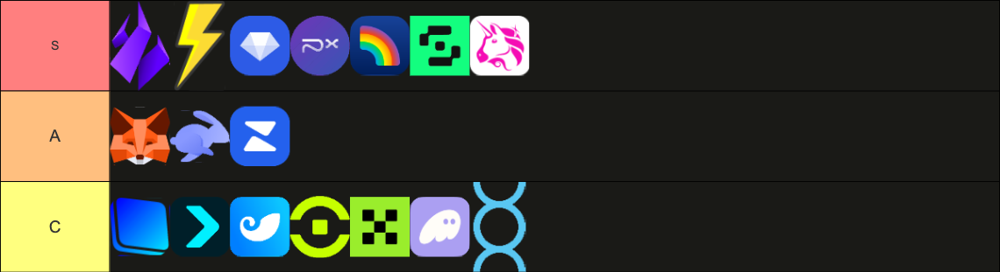

---

Why does source availability matter?

Your wallet holds your private keys.

Without access to your wallet's source code, you can't independently inspect how it's designed to handle your keys, transactions, and data.

Source-available wallets should be the default.

---

Source availability is a major part of wallet verifiability, but it's not enough on its own.

Reproducible builds help verify that the software you're running matches the public source code.

Transparency around external dependencies also matters in understanding how your wallet behaves.

---

Taking it a step further, wallets should strive to be Free & Open Source Software (FOSS).

What's the difference?

Source availability lets anyone inspect a wallet's code.

FOSS goes further: anyone can freely use, modify, and redistribute the code under its license.

---

@ambire

✅ Uses Free & Open Source license (Under GPL-3.0)

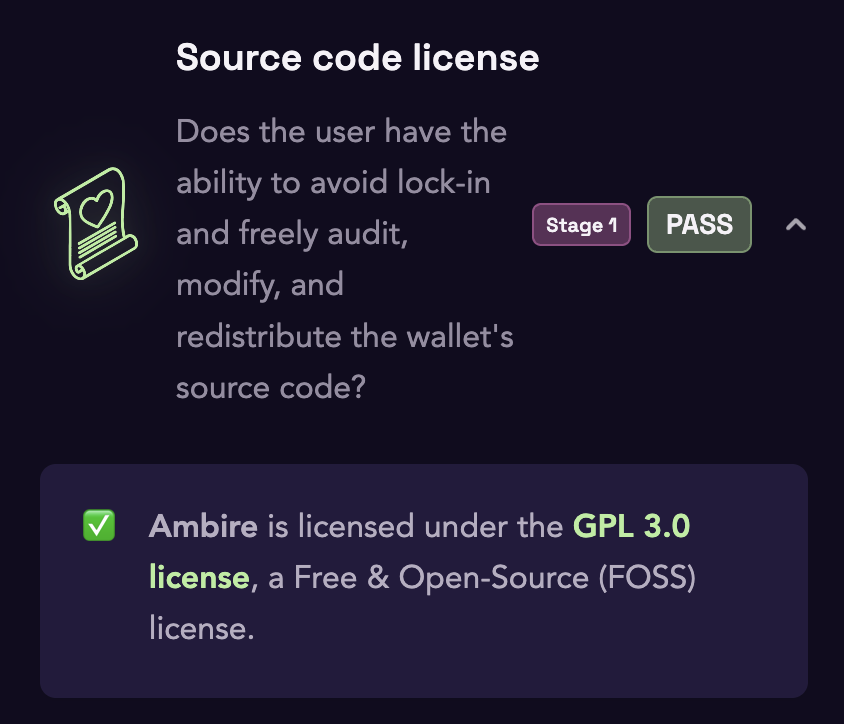

---

@coinbasewallet

❌ Closed source (Proprietary)

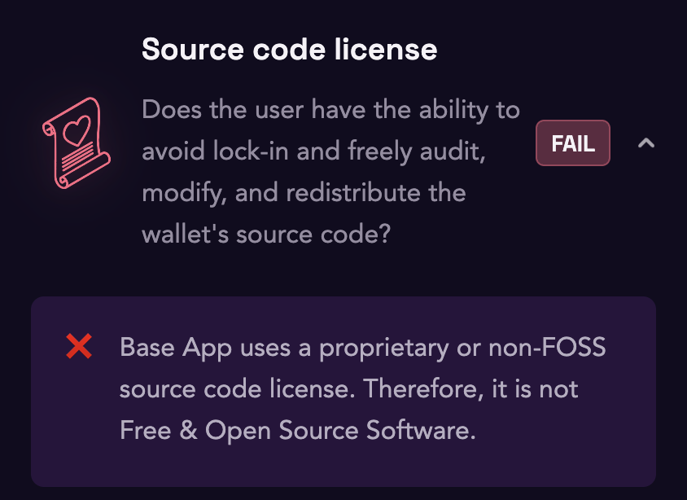

---

@BitgetWallet

❌ Closed source (Proprietary)

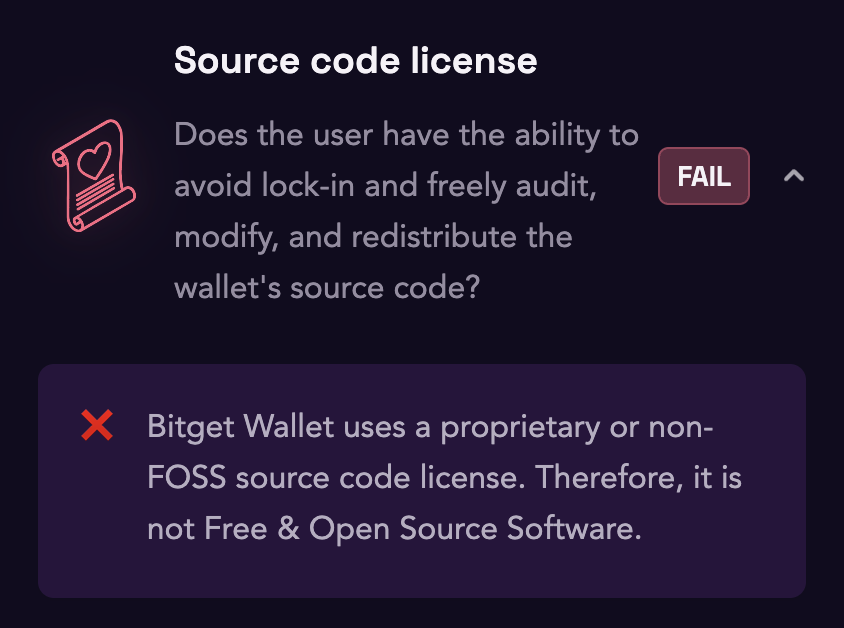

---

@gemwallet

✅ Uses Free & Open Source license (Under GPL-3.0)

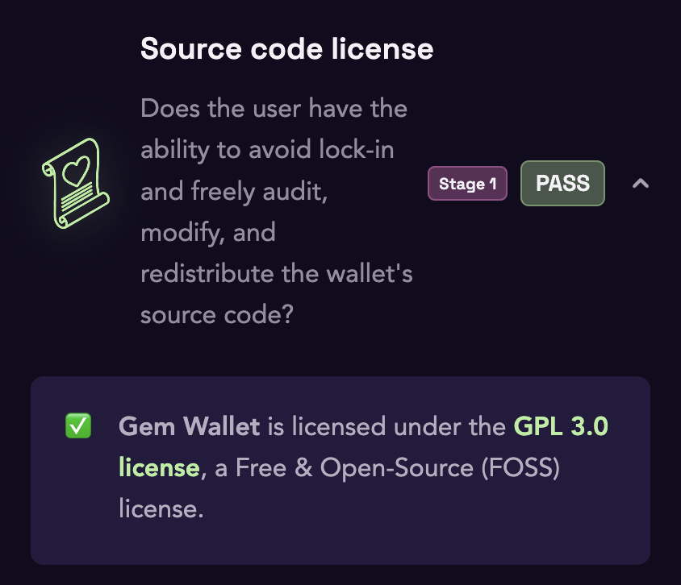

---

@imTokenOfficial

❌ Closed source (Proprietary)

Core code is open source under Apache 2.0, but the app itself is proprietary.

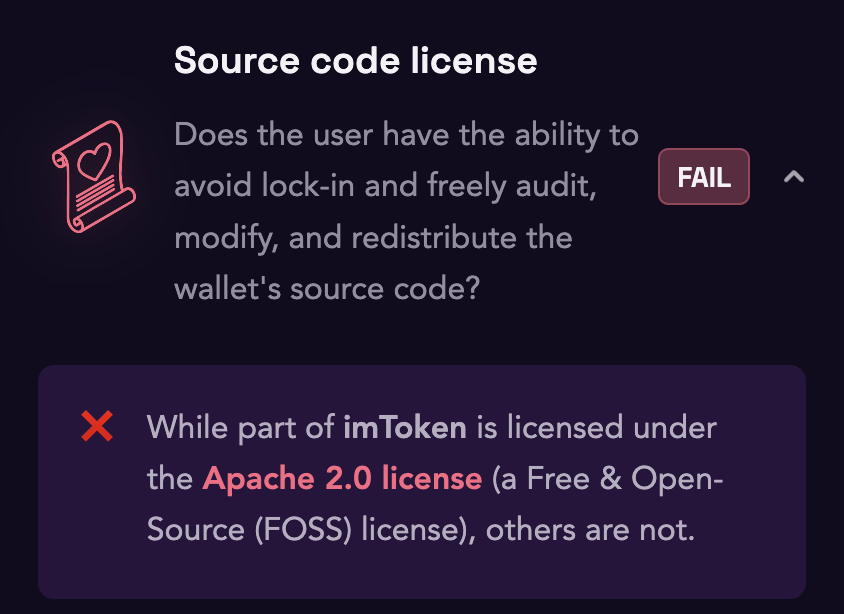

---

@MetaMask

⚠️ Source available, but not FOSS (Proprietary source-available license)

Core packages are MIT, but the extension and mobile app use a proprietary license.

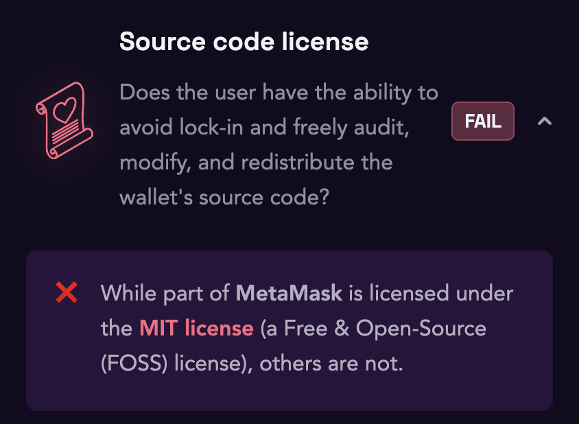

---

@mtpelerin (Bridge Wallet)

❌ Closed source (Proprietary)

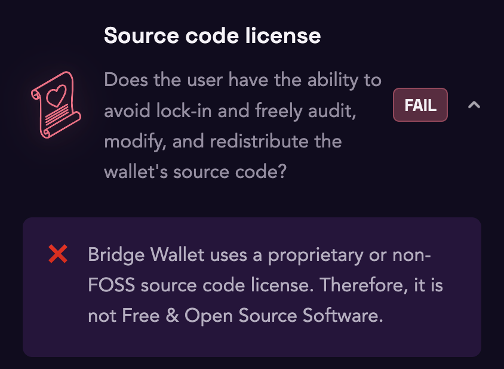

---

@nufiwallet

❌ Closed source (Proprietary)

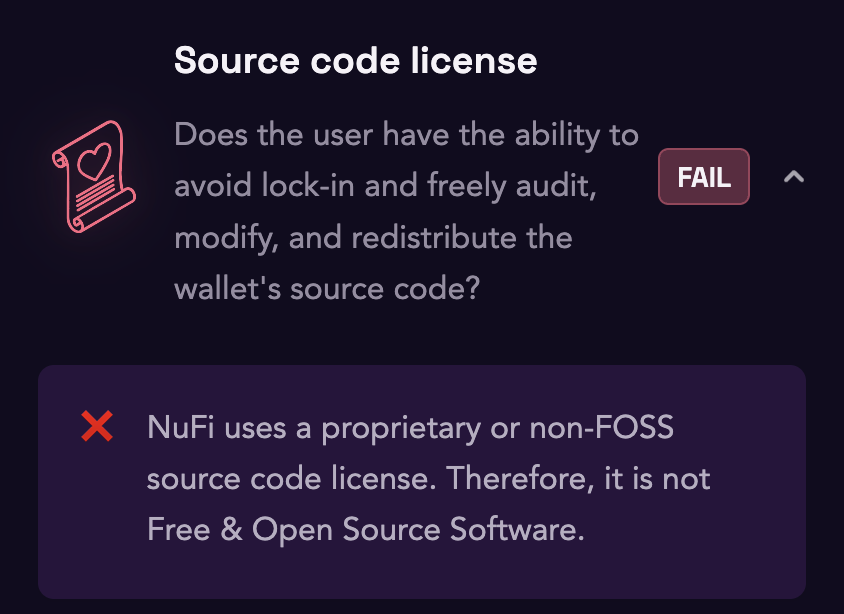

---

@wallet (OKX Wallet)

❌ Closed source (Proprietary)

---

@phantom

❌ Closed source (Proprietary)

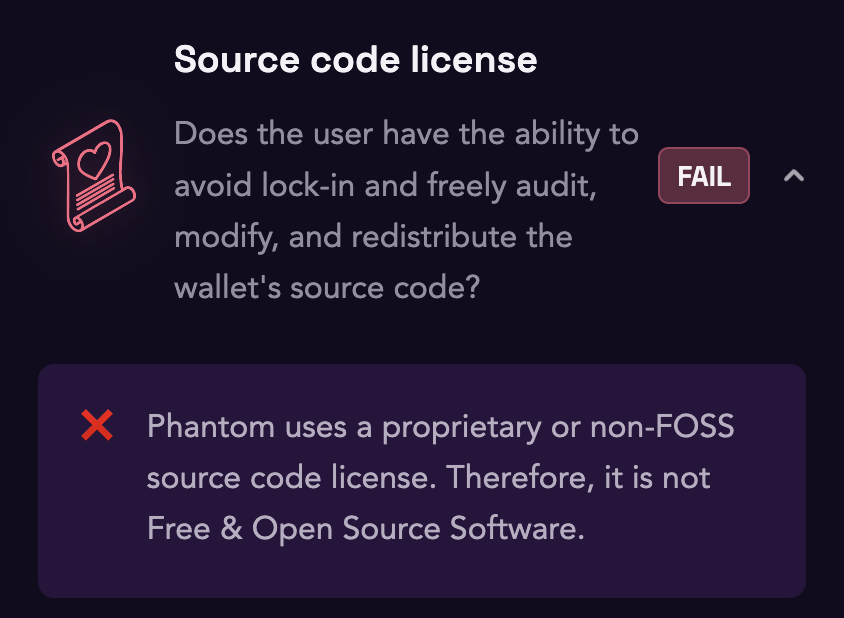

---

@PX_Web3 (PillarX)

✅ Uses Free & Open Source license (Under MIT)

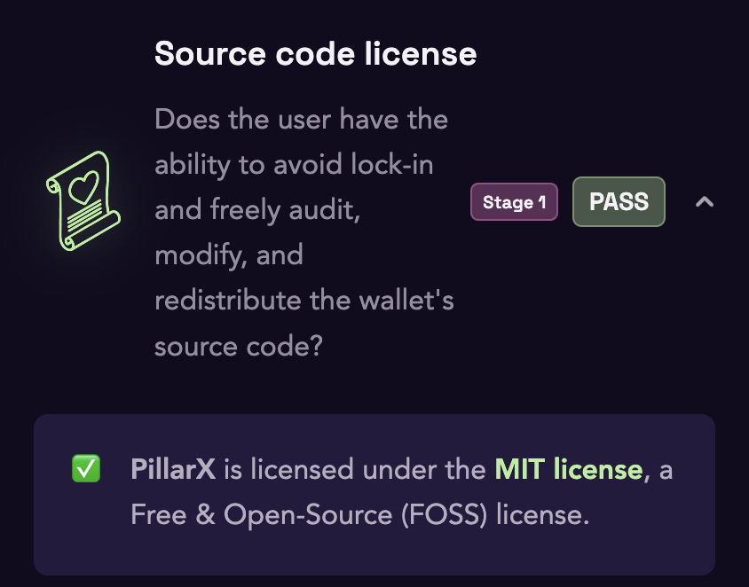

---

@Rabby_io

⚠️ Source available, but not fully FOSS

Browser extension and desktop app: ✅ MIT
Mobile app: ⚠️ Unlicensed (code visible, no license)
Core: ⚠️ rabby-api package is unlicensed

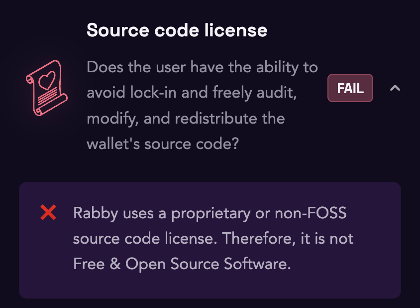

---

@rainbowdotme

✅ Uses Free & Open Source license (Under GPL-3.0)

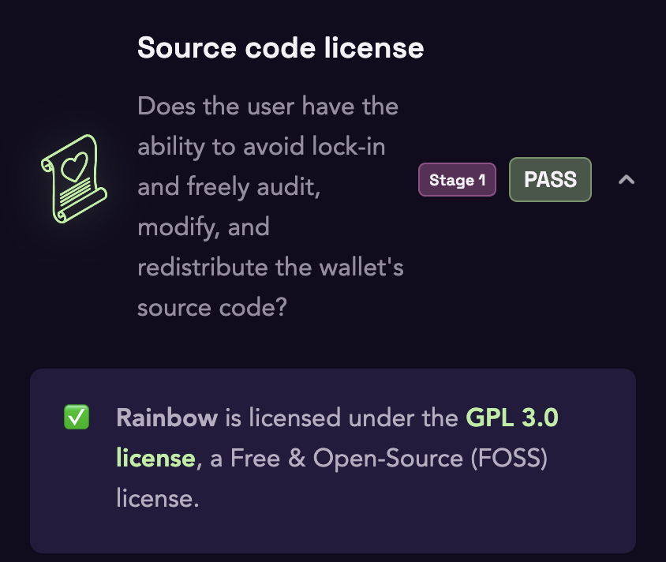

---

@SafeLabs_

✅ Uses Free & Open Source license (Under GPL-3.0)

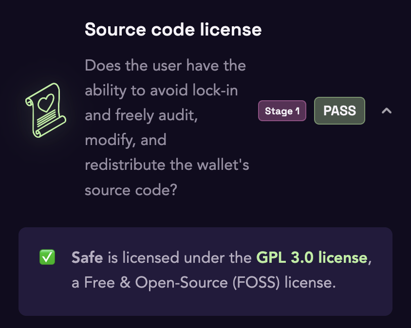

---

@Uniswap (Uniswap Wallet)

✅ Uses Free & Open Source license (Under GPL-3.0)

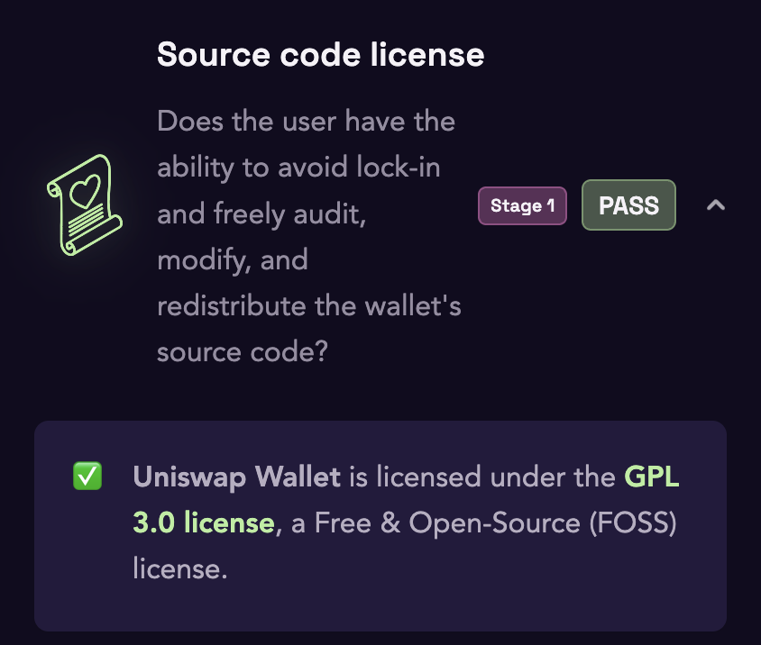

---

@zerion

⚠️ Source available, but not fully FOSS

Browser extension: ✅ GPL-3.0
Mobile app: ❌ Proprietary (only the wallet core is open source, under Apache 2.0)

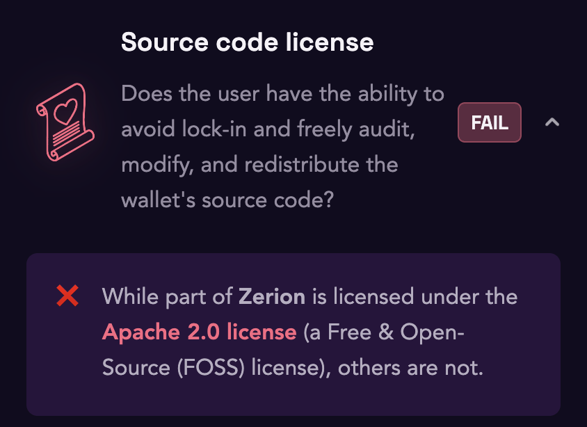

---

Zeus Wallet by @mikemolfetas1

✅ Uses Free & Open Source license (Under MIT)

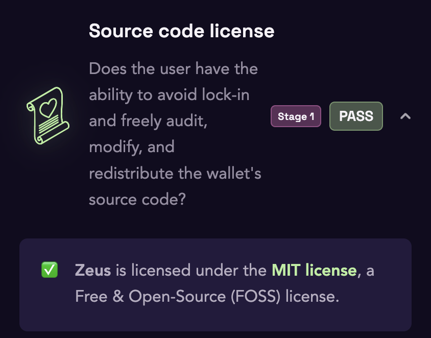

---

10/17 wallets are source available.

Of those, only 7/10 are fully Free & Open Source.

Source availability should be a basic requirement for any Ethereum wallet.

And FOSS should be the standard.

---

Why source availability matters:

Your wallet holds your keys. If the code is closed, you're trusting the provider's word on what it does.

Public source code lets anyone read the code and spot bugs. But without a FOSS license, you can't fork, fix, or ship your own version.

---

Why FOSS should be the standard:

Anyone can audit, modify, and redistribute the code. Users avoid lock-in, and other teams can build on it.

That turns a wallet into a public good, which is what Ethereum is about.

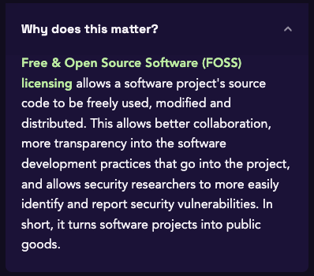

---

If your wallet's source code isn't available, you can't see what it does with your keys, your transactions, or your data.

Is it really an Ethereum wallet?

Ethereum is built on openness, transparency, and not having to trust intermediaries. Those values should land on wallets too, where users actually touch Ethereum.

---

Using a wallet that isn't FOSS yet?

Let them know. Tag them and ask them to open source their code.

Wallets listen to their users.

---

Check out how your wallet stacks up 👇
https://walletbeat.eth.limo/
