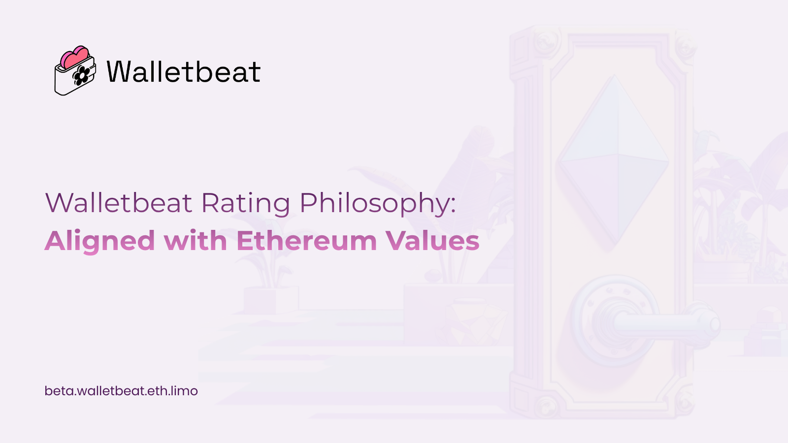
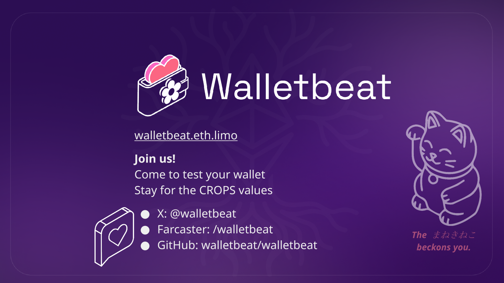

Walletbeat Rating Philosophy: Being aligned with Ethereum values ⬇️
      
🌸 The goal is to align with @ethereum values: Security, Privacy, Self-sovereignty, Transparency, and Ecosystem Direction.

---

🌸 All the attributes' evaluations are based on verifiable behavior of wallets. 

This means, for example, that instead of looking at privacy policies of wallets, evaluations look at the network packets that they send, because that's a much more objective property that wallets do.

If something is not verifiable, that also means that the wallet is failing in some dimension of the transparency value.

---

🌸 Walletbeat cares more about outcomes for the user, as opposed to specific standards. A good example here would be private transfers. 

There are many ways to do private transfers on @ethereum. There's @TornadoCash, @RAILGUN_Project, @0xprivacypools, stealth addresses.

---

And the ultimate goal here is not to pick a solution between them. 

The ultimate goal here is to make sure that users get privacy onchain, and it doesn't really matter what implementation wins out. 

What matters is that it's implemented in an actually privacy preserving manner, and it provides privacy for users onchain.

---

🌸 Attributes' evaluations are also limited to what's technically feasible in the present.

For example, browser extension wallets are not asked to do things browser extensions can't do. So the methodology has to be limited by that principle as well. 

The bar will rise as technology progresses.

---

🌸 The bar is set high first because it is much easier to lower it later, as opposed to starting low and then raising it.

---

If you want to know more about the values, please visit 
https://beta.walletbeat.eth.limo/about/

