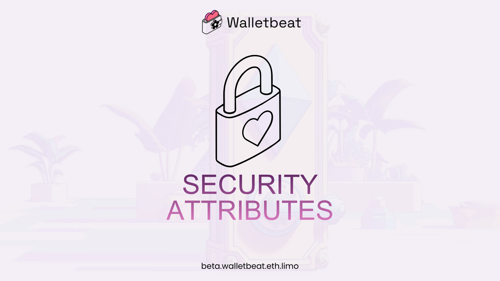
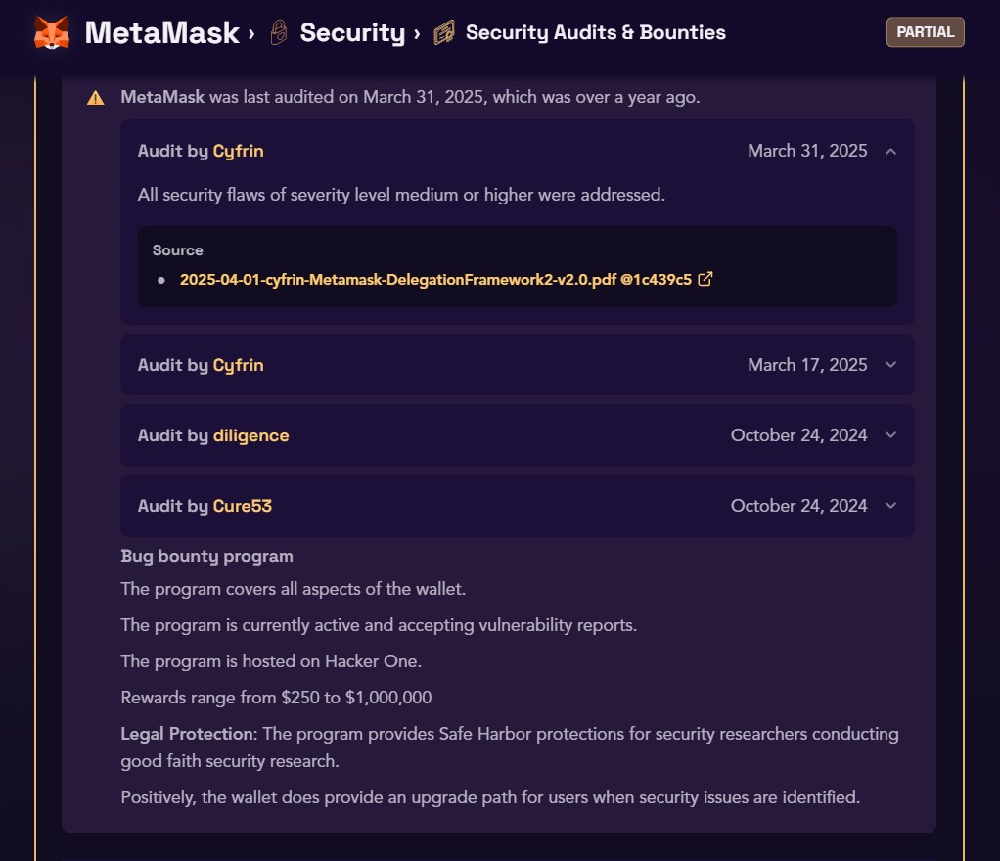
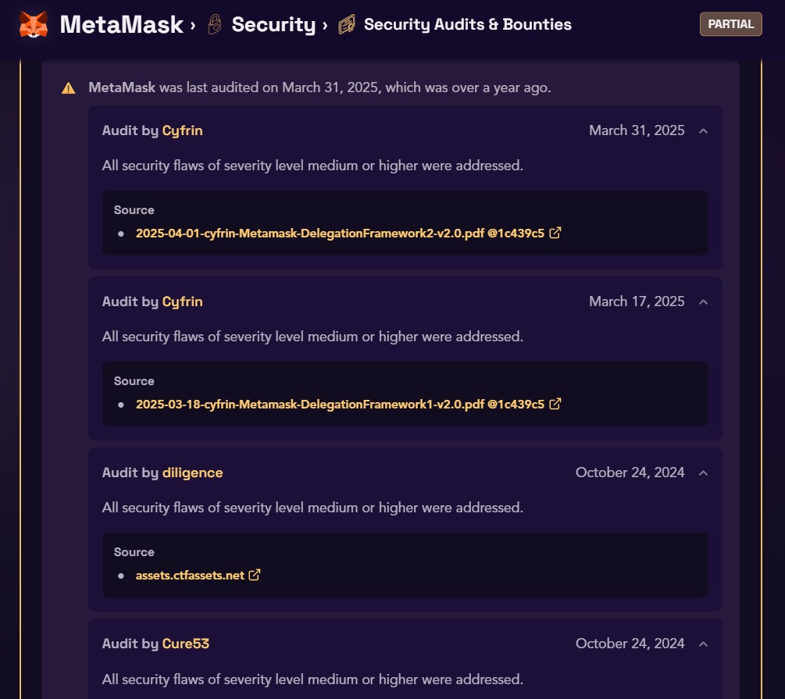
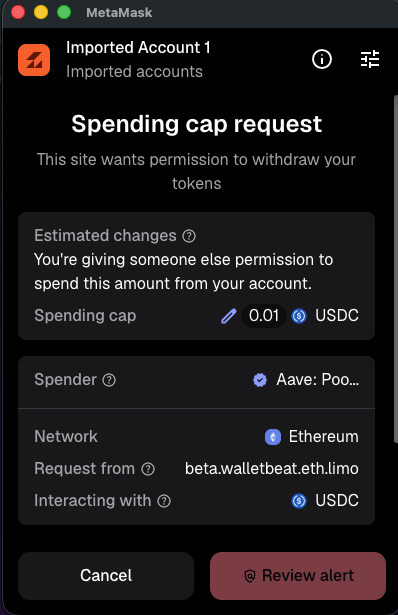
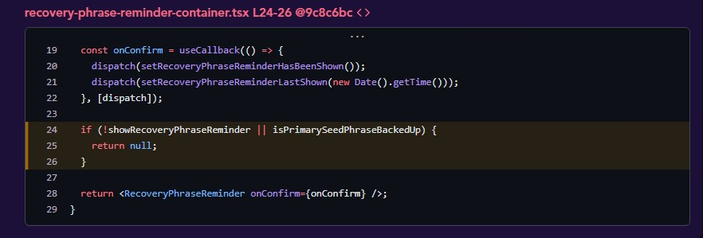
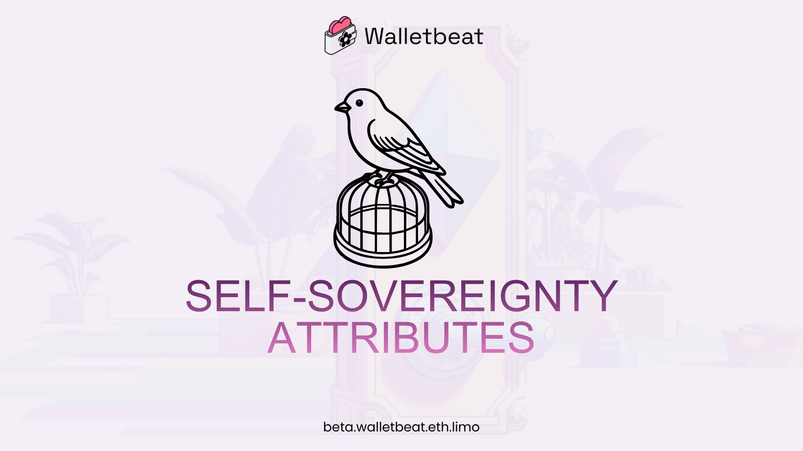
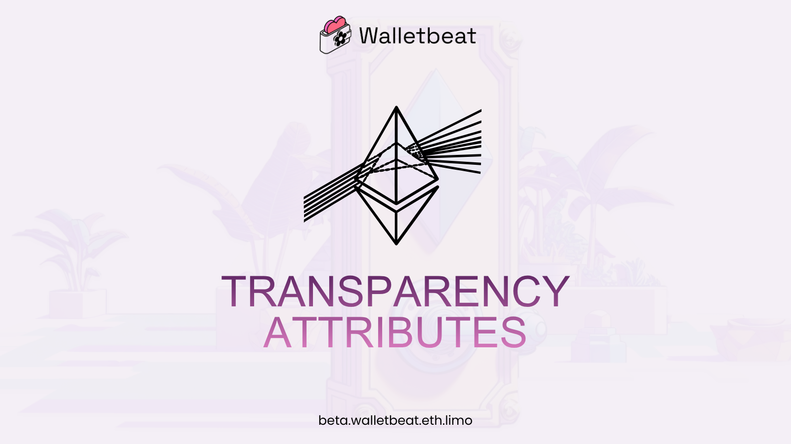
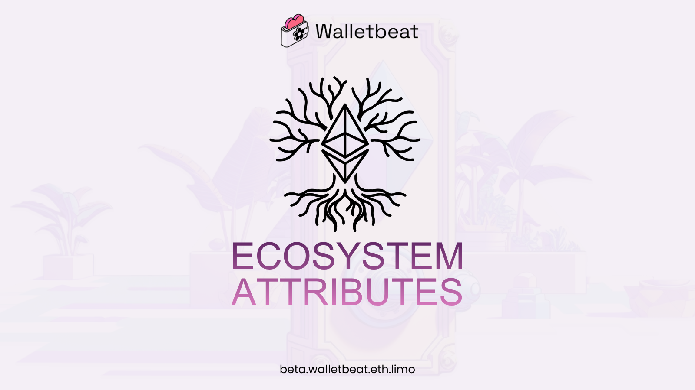
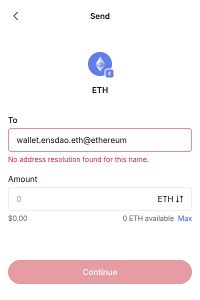
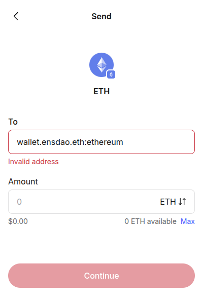

How does @MetaMask stack up against Ethereum’s values?

Ethereum values only matter if users actually experience them. Where MetaMask is making progress, where it’s stuck, and what could be better?

A Walletbeat thread 🧵

---

In this thread, we'll be analyzing @MetaMask against Walletbeat's attributes.

We'll be evaluating this wallet across five dimensions: security, self-sovereignty, transparency, ecosystem alignment and privacy.

---

🔒 1/5 Security

What’s good about @MetaMask’s security?

🗝️ Hardware wallet support
🐛 Bug bounty program

---

🗝️ Hardware wallet support

✅ Ledger, Trezor and GridPlus connect directly over WebUSB. Keystone connects by QR code.

Software wallets supporting hardware wallets means they offer the best of both worlds: a user-friendly interface with enhanced security. Keys stay on the hardware device, and users keep the software wallet interface. 

---

🐛 Bug bounty program

✅ @MetaMask runs an active program on HackerOne covering all aspects of the wallet.

Rewards range from $250 to $1,000,000, with Safe Harbor protections for good faith researchers.

---

What could be better about @MetaMask’s security?

📜 Security audits
🚨 Scam prevention
🔏 Transaction legibility
🥷 Duress resistance

Let’s break it down 👇

---

📜 Security audits

⚠️ @MetaMask was last audited on March 31, 2025, which was over a year ago. 

A wallet does well on this aspect if it has been audited at least once within the last 365 days. This matter in order to ensure the wallet's source code is secure, and remains that way over time.

MetaMask should undergo a new security audit. 

---

🚨 Scam prevention

@MetaMask warns the user about:

Unknown recipients
Address poisoning
Known scam contracts
First-time and newly deployed contracts
Known scam apps

Two gaps 👇

---

⚠️ @MetaMask does not warn you when granting unlimited token approvals.

⚠️ Address and contract checks leak the user’s IP, their Ethereum address, and the contract address to an external provider that can correlate them.

MetaMask says this data isn’t shared beyond Consensys. Walletbeat still counts it as a correlation risk, because the wallet doesn't implement these scam warning features in a privacy-preserving manner.

---

🔏 Transaction legibility

⚠️ @MetaMask supports some transaction legibility features, but not all. 

The wallet displays basic transaction details but may be missing calldata display formats, clear transaction outcome explanations for complex interactions, or simulation capabilities. 

Showing full transaction details is crucial for security.

  

---

🥷 Duress resistance
 
⚠️ @MetaMask protects access behind a lock screen (password and biometric (Face ID / fingerprint)). This slows down an opportunistic attacker, but doesn’t help against someone forcing you to unlock. 

It should implement a duress mode triggered by a separate duress PIN or passphrase. 

---

What are the gaps in MetaMask’s security?

⚓ Chain verification
🔐 Security best practices
🛟 Account recovery

Let’s take a closer look 👇

---

⚓ Chain verification

❌ @MetaMask doesn't verify the integrity of the Ethereum L1 blockchain when retrieving chain state or simulating transactions.

This attribute refers to the ability for participants to verify that the chain data is valid when they interact with it. Without such verification, users rely on trusted external providers to tell them what the state of the blockchain is, similar to the web2 trust model. 

To avoid this, Ethereum was designed to be verifiable on a light client. MetaMask should integrate light client functionality to verify the integrity of Ethereum chain data.

---

🔐 Security best practices

❌ @MetaMask's mobile app declares high-risk OS permissions not required for wallet functionality, increasing the attack surface.

The browser extension injects content scripts into all origins including file:// and other non-web schemes, dramatically increasing the extension attack surface.

---

🛟 Account recovery

❌ @MetaMask implements a Guardian-based account recovery feature which does not pass any of the tested scenarios. 

Key shares are split across Google and/or Apple, and combined with a password-derived key to encrypt a seed phrase backup stored in Consensys’s data store.

Recovery depends on the wallet password and that data store.

---
❌ @MetaMask reminds users to back up their recovery phrase but only if they haven't had their recovery phrase backed up in the first place. Once the user confirms the backup, the reminder is permanently dismissed.

It also does not run the following recommended account recovery drills periodic check-ups: private key check-ups, seed phrase check-ups, guardian account check-ups. 

---

🏰 2/5 Self-sovereignty

What’s good about @MetaMask’s self-sovereignty?

🧳 Account portability
🪚 Account unruggability

---

🧳 Account portability

✅ Accounts follow BIP-39, BIP-32 and BIP-44. Both the seed phrase and private keys can be exported from the extension and the mobile app.

Users can permissionlessly import their Ethereum account into another wallet. This ensures their account is portable and avoids lock-in.

---

🪚 Account unruggability

✅ MetaMask implements a Guardian-based account recovery feature which passes all the tested scenarios when it comes to anti-ruggability.

Seed phrases are generated on the user’s device, and recovery secrets are reconstituted client-side. No external party can take over an account without the user’s consent.

---

What could be better about MetaMask’s self-sovereignty?

🔗 L1 provider independence

⚠️ While @MetaMask allows users to configure custom RPC endpoints, it may still send some requests to its default endpoints before the custom RPC is used.

MetaMask should modify the wallet setup flow to allow the user to configure the RPC endpoint for L1 before making any requests, or should avoid making any such requests until the user can access the RPC endpoint configuration options.

---

And the gaps:

📡 Transaction inclusion
🔑 Permissions management

Here’s the breakdown 👇

---

📡 Transaction inclusion

❌ MetaMask does not support L2 force-inclusion withdrawal transactions on Arbitrum or OP Stack L2s. This means users rely on intermediaries in order to withdraw their funds from these L2s.

MetaMask should add support for creating force-withdrawal transactions for L2s and broadcasting them on L1.

---

🔑 Permissions management

❌ MetaMask provides no way to inspect or revoke token approvals granted to other addresses.

Without the ability to inspect and revoke approvals, users are exposed to risks from unlimited or unnecessary token approvals granted to other addresses.

---

🕵️ 3/5 Transparency

What’s good about MetaMask’s transparency?

MetaMask is:

💰 Transparent about its funding
💸 Transparent about transaction fees

---

💰 Funding transparency

✅ MetaMask is funded by transparent fees and venture capital.

Consensys, which develops MetaMask, raised a $450M Series D led by ParaFi in March 2022. Revenue is published by product line and chain on DeFiLlama.

Wallets must be maintained, regularly audited, and follow the continuous improvements in the ecosystem. This requires a reliable, transparent source of funding.

--- 

💸 Fee transparency

✅ MetaMask shows a complete breakdown of all transaction fees.

It charges 0.875% on built-in swaps, and the same engine powers its bridge.

---

What could be better about MetaMask’s transparency?

📦 Release process (reproducibility)

Let’s dig in 👇

---

📦 Release process

⚠️ MetaMask supports public changelog, artifact signing, and dependency locking, but is missing reproducible or hermetic builds.

To fully pass, MetaMask should add reproducible or hermetic builds. Adding these would allow independent parties to verify that released software corresponds to the published source.

---

What’s the gap in MetaMask’s transparency?

📜 Source code license

❌ While part of MetaMask is licensed under the MIT license (a Free & Open-Source (FOSS) license), others are not.

The core repository contains various packages reused across all MetaMask versions, licensed under MIT. The extension and the mobile app use a proprietary source-available license.

MetaMask should consider licensing all of its code under a Free & Open Source Software license.

---

🌳 4/5 Ecosystem alignment

What’s good about MetaMask’s ecosystem alignment?

💼 Account abstraction via EIP-7702
🌐 Browser integration standards
🧺 Atomic transaction batching
🧩 Hardware wallet interoperability

MetaMask is well aligned with several emerging Ethereum wallet standards.

---

What could be better about MetaMask’s ecosystem alignment?

📇 Address resolution
🌉 Chain abstraction

Here’s what we found 👇

---

📇 Address resolution

⚠️ MetaMask supports sending funds to human-readable ENS addresses such as username.eth, but does not support chain-specific address formats that specify the destination chain.

MetaMask may want to add support for sending funds to chain-specific human-readable addresses. Supporting them would make cross-chain payments easier and less ambiguous.

---

🌉 Chain abstraction

⚠️ MetaMask can display your account's total value across chains and per-chain token balances. It does not, however, show your total balance for a given token (e.g. Ether or USDC) summed up across multiple chains. 

That makes it hard to see how much USDC you have. MetaMask should have a way to see token balances summed up across chains.

This matters for the Ethereum L2 roadmap, which aims to make L2s seamless for users.

---

😎 5/5 Privacy

Privacy is where MetaMask has the most to cover.

Two attributes fail.

---

The two fails:

📨 Private token transfers
🏝️ App isolation

One by one 👇

---

📨 Private token transfers

❌ MetaMask does not support any type of private token transfers.

This means all token transfers made using MetaMask are public information and are recorded forever. 

It should support some form of private token transfers, such as Stealth Addresses, and should make this the primary way to perform token transfers.

---

🏝️ App isolation

❌ When connecting to an app you have connected to before, MetaMask does not default to the same set of addresses as you had last selected.

That makes it easy to expose more addresses than intended, letting the app correlate more of the user’s activity.

MetaMask should locally store each app’s address set locally and reuse it by default.

---

So, where does @MetaMask stand?

Across Walletbeat's five dimensions, it has a mix of strengths and areas for improvement.

Solid areas: account portability, unruggability, hardware wallet support, bug bounty program, transparent funding, and signed release artifacts.

Biggest gaps: the source code license, chain verification, account recovery, approval management and private transfers.

---

Several fixes are needed:

A new security audit
Unlimited approval warnings
An approvals view with revoke
Remembering per-app addresses
Removing unneeded mobile permissions

None of them needs an architectural rewrite.

---
Overall

@MetaMask has the fundamentals of ecosystem alignment covered.

The attribute that can still improve is security.

Privacy is the area that needs more improvement.

Let’s keep pushing CROPS in wallets 🌸

---

See @MetaMask’s full breakdown on Walletbeat:

https://beta.walletbeat.eth.limo/metamask

