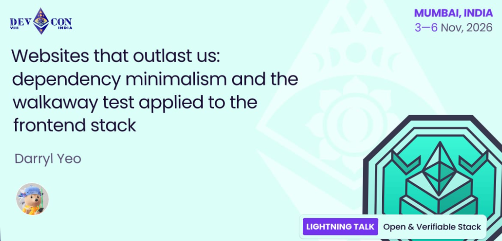

The only things worth building are the ones that keep working after everyone walks away.

@darryl__yeo is joining Devcon 8 to explore "Websites that outlast us: dependency minimalism and the walkaway test applied to the frontend stack."

---
@darryl__yeo is the frontend lead at Walletbeat, a decentralized data wrangler, and DeFi/Web3 builder.

He also built http://blockhead.info and is a veteran hackathon bounty hunter.

Catch this talk on the Open & Verifiable Stack track!

---
Why should you listen to us about wallets?

We're researchers, developers, and Ethereum ecosystem contributors united by one goal:

Making wallets more secure, private, and self-sovereign.

Join us in Mumbai. 🇮🇳

