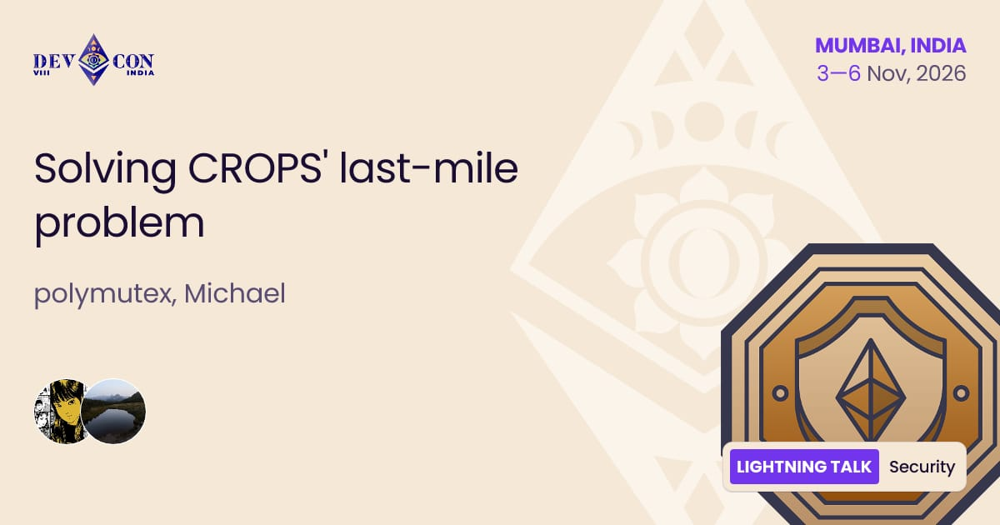
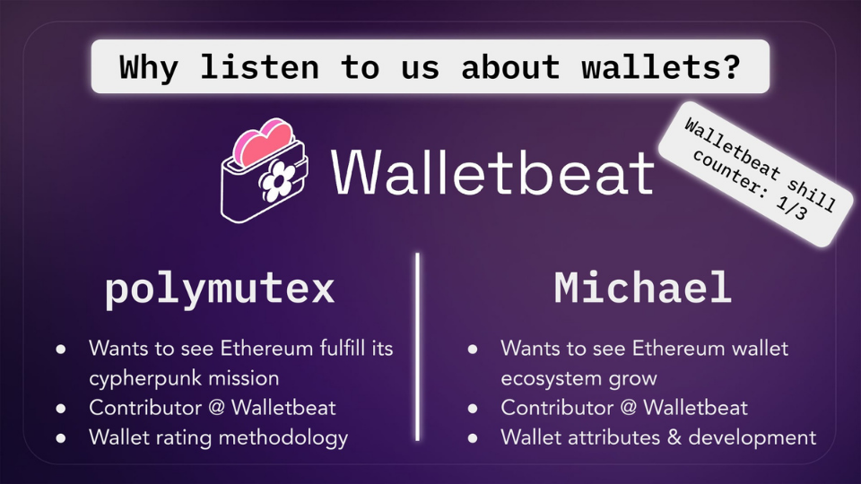
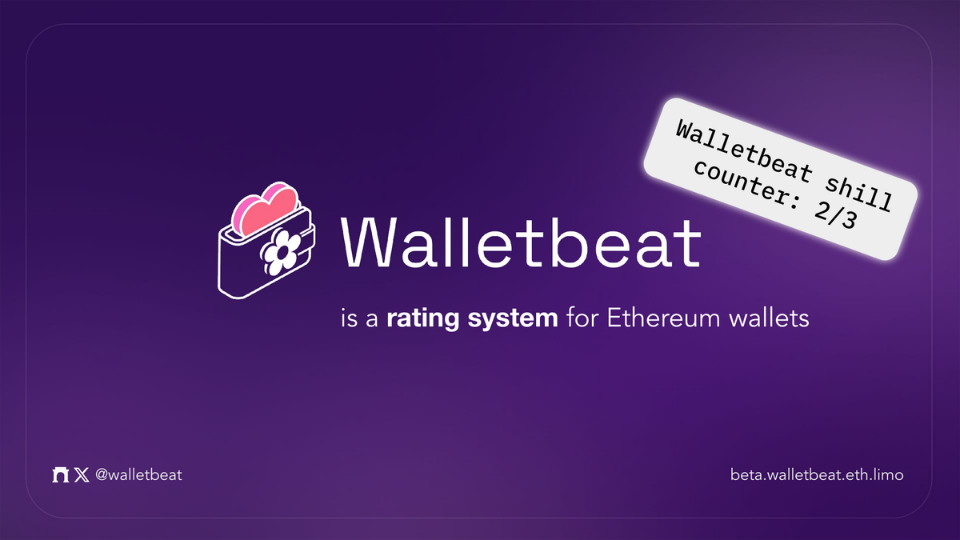

Solving CROPS' last-mile problem

Walletbeat contributors @polymutex & @0xmattmatt will take the stage at @EFDevcon on Futures Worth Building track 👇

---

Wallets are how users use and experience Ethereum. 

Doesn't matter how CROPS-y the protocol layer is: no CROPS in wallets ⇒ no CROPS for users. 

In this talk, we map CROPS values to wallet attributes, and introduce Walletbeat as a public good that aims to shine a light on CROPS' last mile: the access layer.

---

This talk walks through:

🌸 Why CROPS faces a last-mile problem (at the access layer)
🌸 How CROPS maps to wallets
🌸 What the current wallet landscape looks like
🌸 What obstacles exist for wallets to fully embody Ethereum values
🌸 How "dashboard organizations" like Walletbeat fit in solving the last-mile problem.

We'll cover where the Ethereum wallet ecosystem is making progress, where it's stuck, and what meaningful CROPS alignment actually looks like in practice for modern wallets.

---

Why should you listen to us about wallets?

@polymutex & @0xmattmatt are core contributors at Walletbeat.

Polymutex wants to see Ethereum fullfil its cypherpunk mission. That is why he is working on Walletbeat specifically. He has been working on defining the methogology that we use to rate software wallets.

Matt wants to see the Ethereum wallet ecosystem grow. He mainly focuses on wallet attributes and development.

---

Walletbeat is a rating system for Ethereum wallets. A place where users know what to expect from a wallet, developers have a clear standard to build toward, and wallets compete on Ethereum values.

---

Walletbeat aims to be an L2BEAT-like public good for wallets: an open framework that evaluates Ethereum wallets through CROPS values.

Join us in Mumbai 🇮🇳

