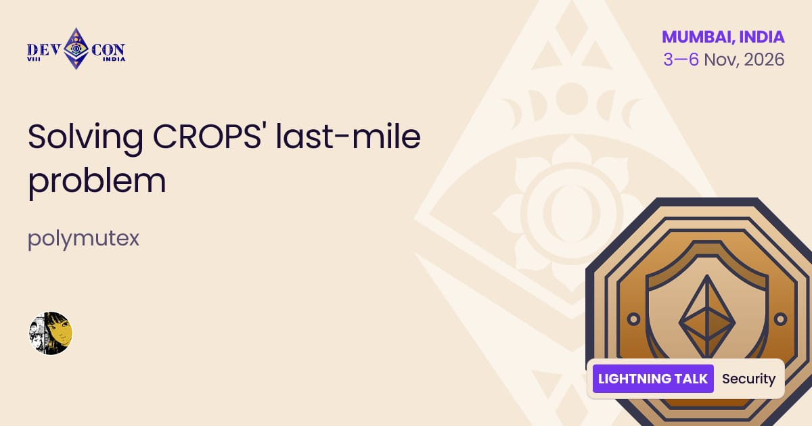
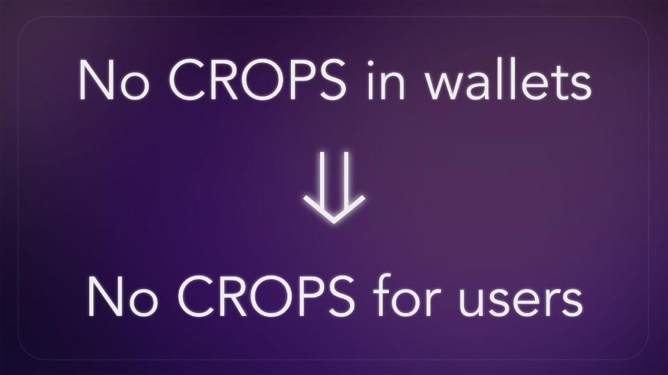
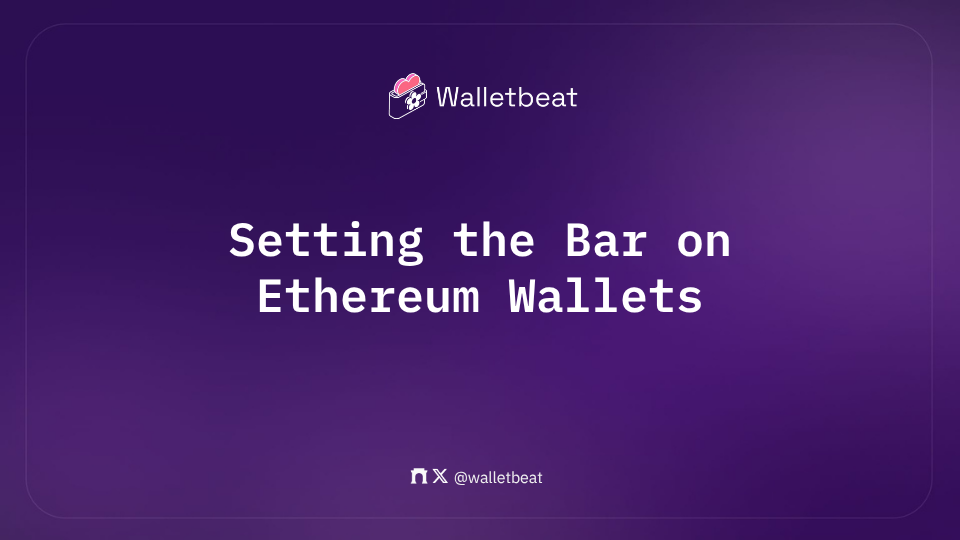

Solving CROPS' last-mile problem

Walletbeat contributor @polymutex will take the stage at @EFDevcon on Futures Worth Building track 👇

In this talk, @polymutex introduces Walletbeat as a public good that aims to shine a light on CROPS' last mile: the access layer.

---

Wallets are how users use and experience Ethereum. 

Doesn't matter how CROPS-y the protocol layer is: no CROPS in wallets equals no CROPS for users. 

Like L2BEAT, Walletbeat aims to improve the wallet ecosystem through open, transparent, and evidence-based evaluations. Pushing CROPS to wallets, we ensure Ethereum values make it all the way to users.

---

This talk walks through:

🌸 Why CROPS faces a last-mile problem (at the access layer)
🌸 What obstacles exist for wallets to fully embody Ethereum values
🌸 How "dashboard organizations" like Walletbeat fit in solving the last-mile problem.

---

Why should you listen to us about wallets?

@polymutex wants to see Ethereum fulfill its cypherpunk mission. Hence, the Walletbeat revamp in 2025, with a more in-depth focus on Ethereum alignment and richer data about individual wallets.

---

Walletbeat is a rating system for Ethereum wallets. A place where users know what to expect from a wallet, developers have a clear standard to build toward, and wallets compete on Ethereum values.

Join us in Mumbai 🇮🇳

