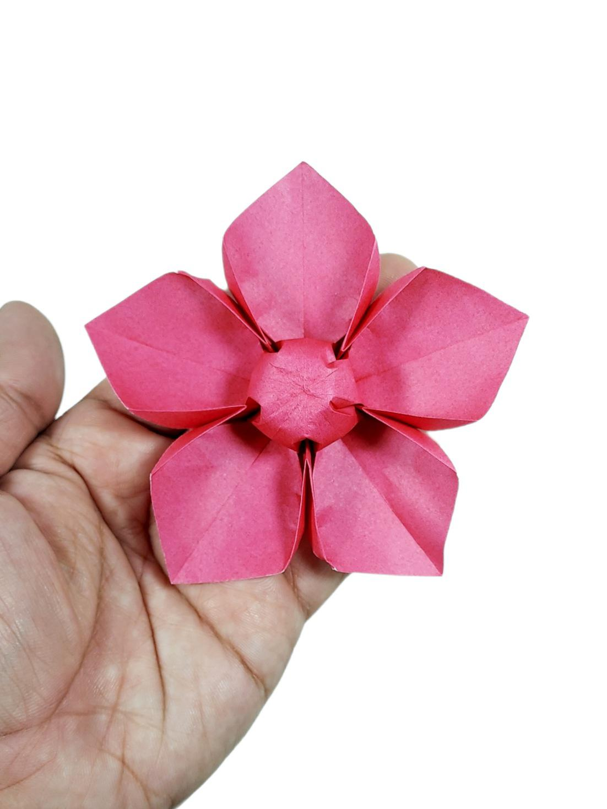

Walletbeat is heading to Mumbai for @EFDevcon!

We’ll be showcasing how we evaluate Ethereum wallets, what goes into their ratings, and how our findings are helping improve the wallet ecosystem.

Come visit us at our booth!

See how wallets get rated, what the data means, and what wallets have changed because of it 👇

---

🌸 What’s happening at the booth:

- Demos on how we rate wallets, for anyone who wants to fill in wallet data
- Overviews of Walletbeat’s website and how to interpret its data
- Check how the wallet you use performs in our ratings
- Origami paper for folding flowers, all the way from Japan thanks to @darryl__yeo
- Roast your wallet at the Wallet Complaints Whiteboard!

---

@polymutex, @0xMattmatt, @darryl__yeo and @lucilajuliana will be there. Come say hi.

See you there 🌸

