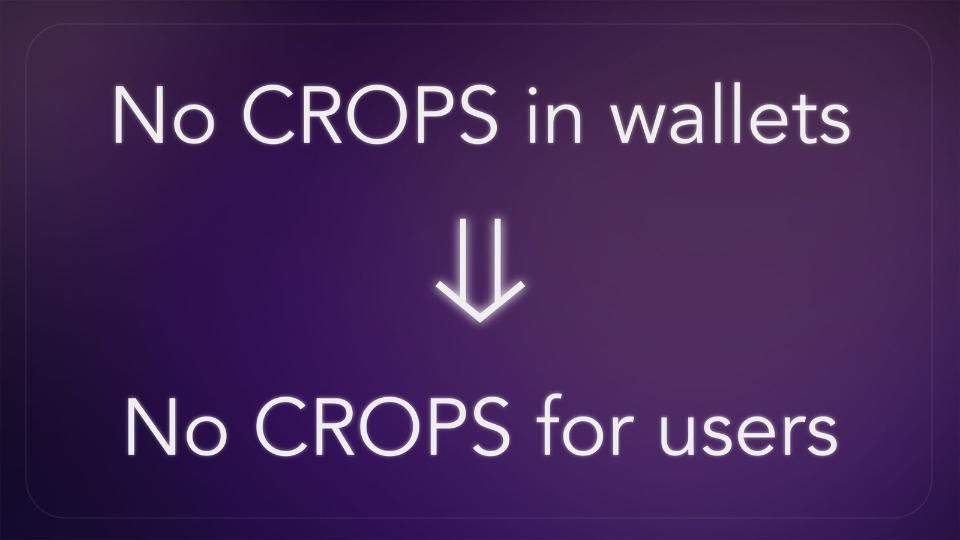

Wallets should play well within the ecosystem. What ecosystem alignment actually looks like in practice? 

Here's how Walletbeat evaluate this attribute.

A Walletbeat thread 🧵

---

Account abstraction 👤

Is the wallet Account Abstraction ready?

User experience on Ethereum has historically suffered from the limitations of EOAs, which is the type of account most Ethereum users use today. By contrast, smart wallet accounts offer many UX and security improvements. 

Wallets are rated based on whether they support:
- EIP-7702: Account Abstraction via smart contract authority delegation for Externally-Owned Accounts (EOAs) wallets. 
- ERC-4337: Account Abstraction for smart contract wallets. 

---
Why does this matter?

EIP-7702 creates a clean path for existing EOAs to obtain all the UX benefits of smart wallet accounts and account abstraction, without the need for users to switch to a different account address. 

This represents a large User Experience upgrade for all Ethereum EOA users.

---

Address resolution 📇

Can the wallet send funds to human-readable Ethereum addresses?

Ethereum addresses are unreadable to humans. Address naming registries like ENS partially solve this problem.

Some address format standards improve upon this further by including the destination chain information as part of the address itself.

---
Why does this matter?

Ethereum addresses are hexadecimal strings (0x...) which are unreadable to humans.

Additionally, the users need to ensure that they are sending funds on the correct chain, increasing the potential for mistakenly sending funds to the wrong place or the wrong chain.

---

Browser integration 🌐

Does the wallet support all the prominent standards for web browser integration?

Wallets are rated based on whether they implement the following Ethereum standards for web browser integration:
- EIP-1193 JavaScript Provider API
- EIP-2700 JavaScript Provider Events
- EIP-6963 Multiple JavaScript Providers

---

Why does this matter?
The Ethereum community has defined web browser integration standards, which dictate how wallets and web pages can interact with each other.

By ensuring that wallets implement this standard interface, applications automatically support all wallets that implement it. 

This ensures compatibility across wallets, and that the Ethereum wallet ecosystem remains competitive thanks to wallet interoperability.

---

Chain abstraction 🌉

Does the wallet smooth out the complexities of dealing with multiple chains?

Ethereum activity is not limited to the main L1 chain; a lot of activity has moved onto rollups and Layer 2 chains. This has allowed Ethereum to scale beyond what its L1 chain can handle, but has also introduced complexity and fragmentation for users and wallets to deal with.

Wallets are rated based on how much of the complexity involved in dealing with multiple chains is abstracted away from users, while keeping risks and fees transparent.

To get a passing rating, wallets must be cross-chain aware in how they display account value and individual token balances.

---

Why does this matter?

Wallets must now deal with token balances fragmented across multiple chains.

To address the UX impact of this complexity, wallets should provide features to abstract away these issues, while remaining transparent to the user when cross-chain bridging risks or fees are involved.

---

Transaction batching 🧺

Does the wallet support bundling multiple operations as a single transaction?

Transaction batching is one of the longstanding features without which Ethereum user experience (UX) has suffered. One of the most common pain points for DeFi, for example, has been the need to perform separate "token approval" transactions, followed by a separate transaction to actually execute the user's original intent.

---

Why does this matter?

Smart account types such as ERC-4337 and EIP-7702 unlock the ability to perform multiple operations as a single transaction. This is exposed to applications through EIP-5792 Wallet Call API.

To qualify for a passing rating, the wallet must support at least one type of smart account, implement EIP-5792 Wallet Call API and support atomic transaction bundles.

---

Hardware wallet interoperability 🧱

Does the wallet support directly connecting to hardware wallets from a plurality of manufacturers?

This check is only about hardware wallet interoperability. Wallets are evaluated based on whether they directly integrate with hardware wallets from a plurality of major hardware wallet manufacturers.

A wallet receives a passing rating if it supports hardware wallets from at least 3 major hardware wallet manufacturers:Ledger, Trezor, Keystone, GridPlus, imKey.

---

Why does this matter?

Supporting multiple hardware wallet manufacturers preserves a healthy, open, competitive, interoperable market for hardware wallets.

It also increases the total addressable market of users for the software wallet, as users that already own a specific hardware wallets will want to use a software wallet that supports it.

---

Wallets are how users use and experience Ethereum. Doesn't matter how CROPS-y the protocol layer is: no CROPS in wallets means no CROPS for users.

Ethereum values, like Ecosystem alignment, only matter if users actually experience them.

---

Please visit our website to see the current wallet landscape 🌸 

Let's keep pushing CROPS in wallets.

https://beta.walletbeat.eth.limo/about/

