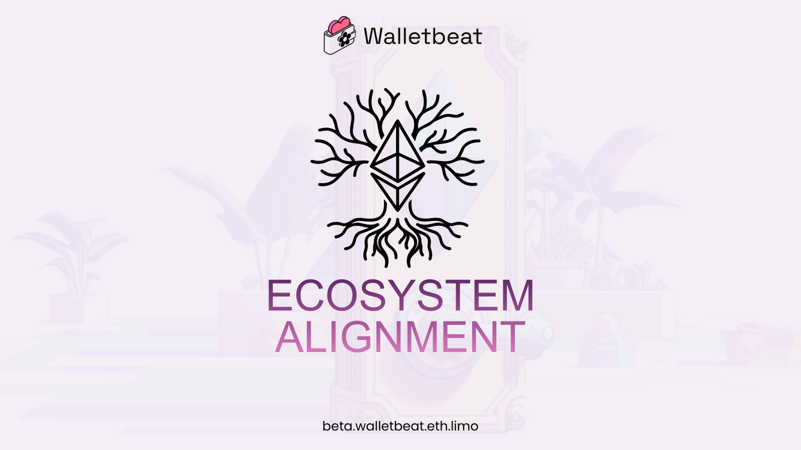
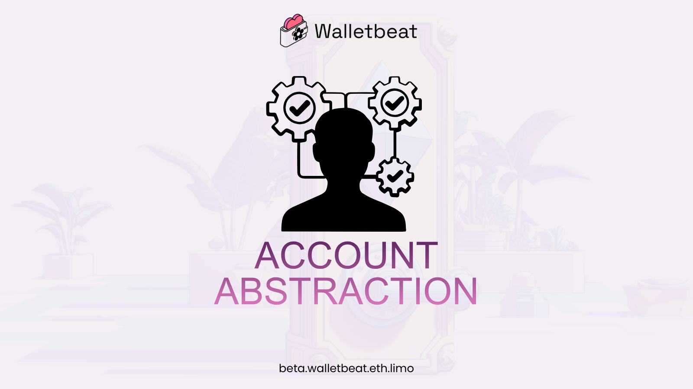
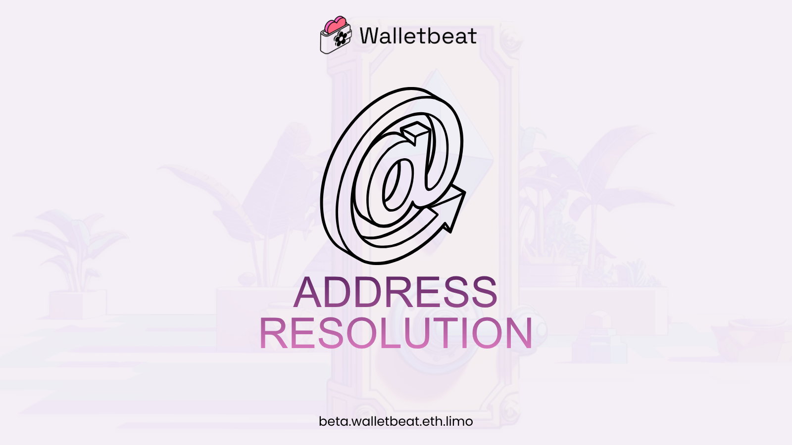
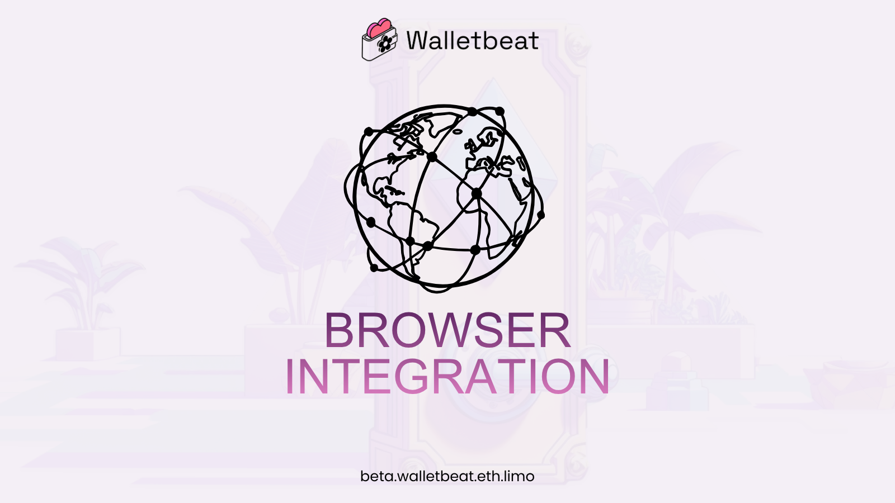
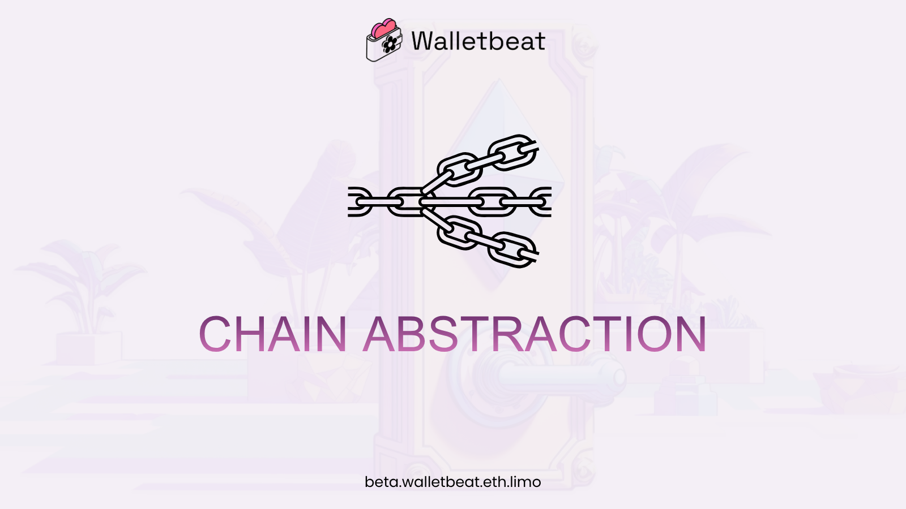
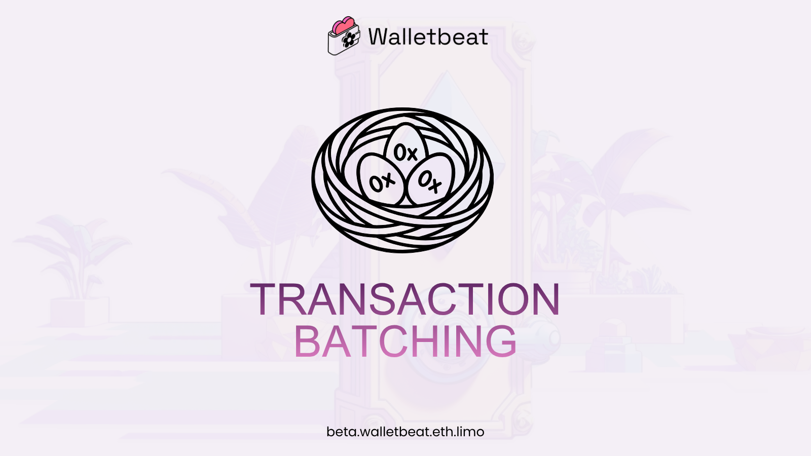
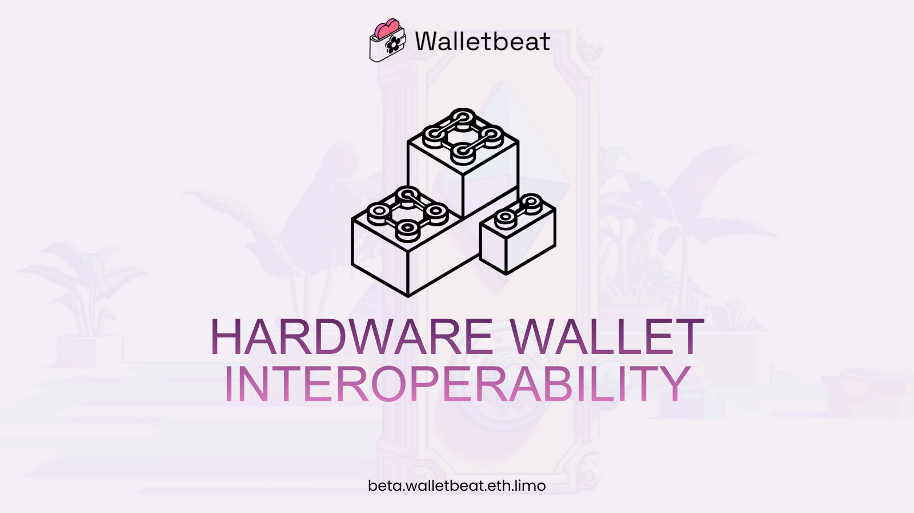

What does ecosystem alignment actually look like in practice? 

Beyond CROPS, there are a few things that are valuable for wallets to have. But they don't neatly fit into any of the CROPS values. And they're all generally around making sure that the wallet plays well in the Ethereum wallet ecosystem. 

Here's how Walletbeat evaluates this attribute 👇

---

Account abstraction 👤

Is the wallet Account Abstraction ready?

User experience on Ethereum has historically suffered from the limitations of EOAs, which is the type of account most Ethereum users use today. By contrast, smart wallet accounts offer many UX and security improvements. 

Wallets are rated based on whether they support EIP-7702 or ERC-4337.

---

EIP-7702 creates a clean path for existing EOAs to obtain all the UX benefits of smart wallet accounts and account abstraction, without the need for users to switch to a different account address. This represents a large User Experience upgrade for all Ethereum EOA users.

ERC-4337 allows users of Ethereum to use smart contract account features. This gives users better UX and more flexibility over how their wallet is secured and recoverable, can be used to avoid needing to keep the wallet topped up with Ether to pay for gas fees, etc.

---

Address resolution 📇

Can the wallet send funds to human-readable Ethereum addresses?

Wallets should support ENS resolution. This solves the unreadability of Ethereum addresses.

Some address format standards improve upon this further by including the destination chain information as part of the address itself.

---

Ethereum addresses are long hexadecimal strings, so they are unreadable to humans. 

Phishing scams have used this to trick users into sending funds to invalid addresses, by generating lookalike-addresses and tricking users into copy/pasting them without noticing the difference.

---

Browser integration 🌐

Does the wallet support all the prominent standards for web browser integration?

Browser integration standards make sure that wallets integrate with apps in a way that is transparent, open, and competitive. This keeps competition open and puts every wallet on a level playing field.

---

The Ethereum community has defined web browser integration standards, which dictate how wallets and web pages can interact with each other.

By ensuring that wallets implement this standard interface, applications automatically support all wallets that implement it. 

This ensures compatibility across wallets, and that the Ethereum wallet ecosystem remains competitive thanks to wallet interoperability.

---

Chain abstraction 🌉

Does the wallet smooth out the complexities of dealing with multiple chains?

Wallets are rated based on how much of the complexity involved in dealing with multiple chains is abstracted away from users, while keeping risks and fees transparent.

To get a passing rating, wallets must be cross-chain aware in how they display account value and individual token balances.

---

A lot of Ethereum activity has moved onto rollups and Layer 2 chains. This has introduced complexity and fragmentation for users and wallets to deal with.

To address the UX impact of token balances fragmented across multiple chains, wallets should provide features to abstract away these issues, while remaining transparent to the user when cross-chain bridging risks or fees are involved.

---

Transaction batching 🧺

Does the wallet support bundling multiple operations as a single transaction?

Transaction batching is one of the longstanding features without which Ethereum user experience has suffered. One of the most common pain points for DeFi, for example, has been the need to perform separate "token approval" transactions, followed by a separate transaction to actually execute the user's original intent.

---

Users don't want to approve every transaction. Transaction batching can solve that problem without giving contracts unlimited spending power.

It gives users a better UX: Approve the exact amount AND swap at the same time, in a single transaction. No need for unlimited approvals. No lingering permissions afterward.
---

Hardware wallet interoperability 🧱

Does the wallet support directly connecting to hardware wallets from a plurality of manufacturers?

Wallets are evaluated based on whether they directly integrate with hardware wallets from a plurality of major hardware wallet manufacturers.

A wallet receives a passing rating if it supports hardware wallets from at least 3 major hardware wallet manufacturers.

---

Supporting multiple hardware wallet manufacturers preserves a healthy, open, competitive, interoperable market for hardware wallets.

It also increases the total addressable market of users for the software wallet, as users that already own a specific hardware wallets will want to use a software wallet that supports it.

---
Ecosystem attributes refer to present-day Ethereum ecosystem priorities and transitions that impact the feature set of Ethereum wallets. 

Unlike other attribute groups, which are mostly timeless principles, the set of ecosystem attributes should be expected to change quickly as the Ethereum ecosystem itself evolves.

---

Please visit our website to see the current wallet landscape 🌸 

Let's keep pushing CROPS in wallets.

https://beta.walletbeat.eth.limo/about/

