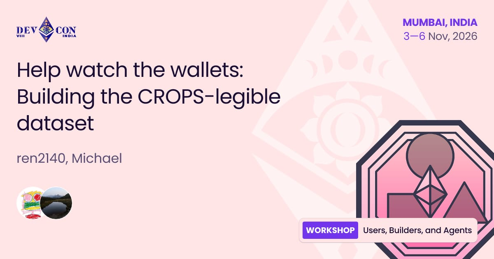
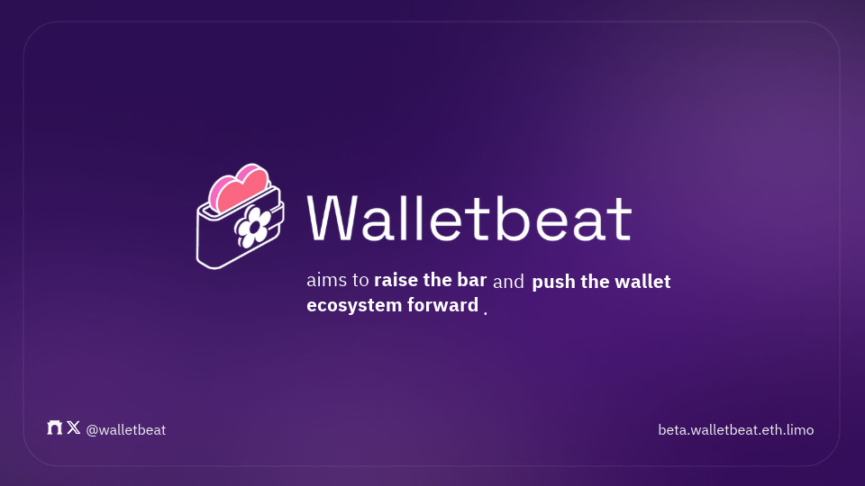

Help watch the wallets contributing verified wallet data 👇

Anyone in the Ethereum community can contribute data to Walletbeat to help users understand how CROPS maps to wallets. 

At this @EFDevcon workshop, @0xmattmatt will guide you through contributing one verified wallet attribute end to end. 

---

Walletbeat aims to make CROPS legible for wallets, and this workshop grows the number of people able to contribute data to further this mission.

---

@0xmattmatt will share how to gather evidence using the proper references (e.g. screenshots, direct links, etc.), verify the evidence is correct, and contribute to the Ethereum community by helping evaluate wallets through Walletbeat, and pushing the wallet ecosystem forward.

---

We'll discuss best practices for capturing evidence, writing entries and opening PRs. No coding skills required.

You will leave this workshop with the confidence to begin contributing data to Walletbeat and open your first PR.

---

Walletbeat is an open source database that grades wallets based on CROPS values.

Help watch the wallets! 🫡 

See you in @EFDevcon 

https://beta.walletbeat.eth.limo/
