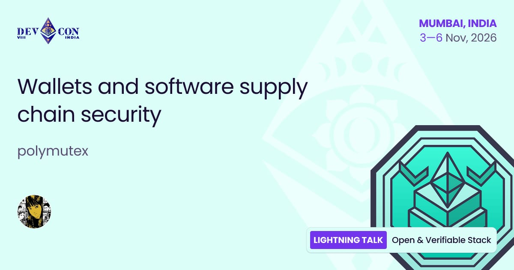

Software supply chain directly impacts wallets' security, and therefore user funds' security. A compromised dependency in a wallet means a compromised wallet, which means compromised users.

@polymutex joins @EFDevcon to explore how should wallets protect against software supply chain attacks

Catch this lightning talk on the Open and Verifiable Stack 👇

---

Wallets are one of the highest-stakes pieces of software in crypto. Yet your wallet probably depends on a few dozen random NPM packages, recursively depending on thousands of others. 

In the face of NPM package compromises, such as the Axios hack earlier this year, how should wallets protect against software supply chain attacks and make their build processes more robust?

---

Learn about existing measures for software supply chain integrity, their underlying concepts, why they are important, and how to implement these processes in your wallet's software development process.

---

Walletbeat is a rating system for Ethereum wallets. A place where users know what to expect from a wallet, developers have a clear standard to build toward, and wallets compete on Ethereum values.

See you in Mumbai 🇮🇳

