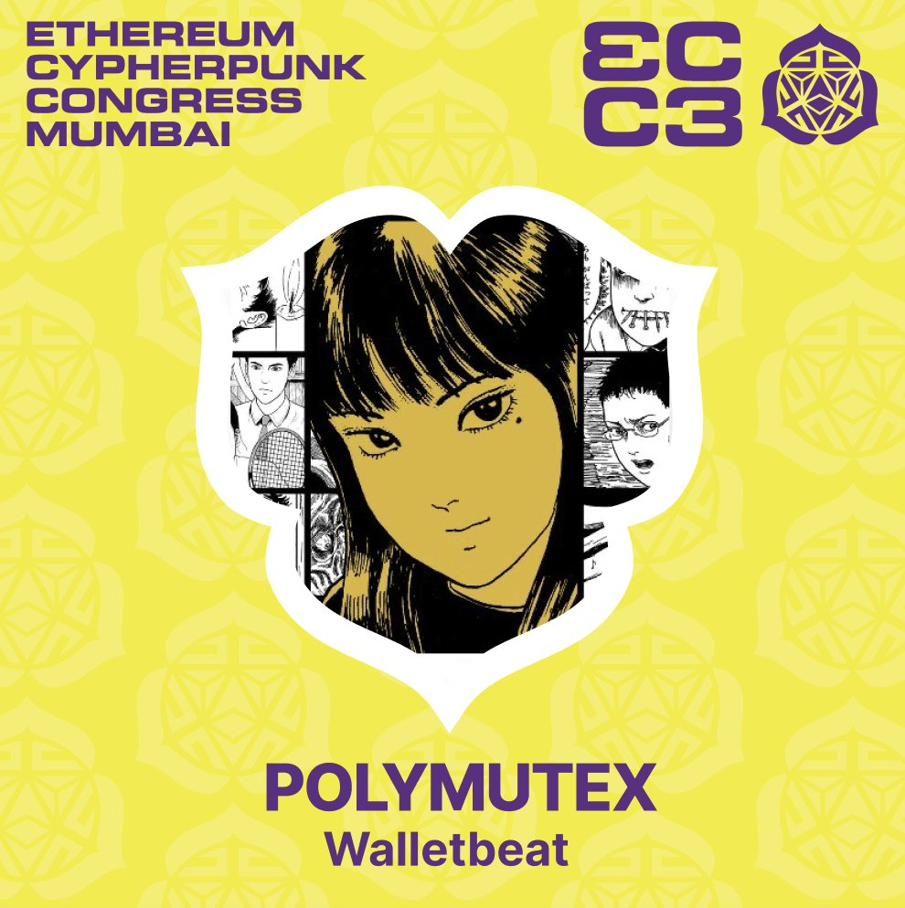
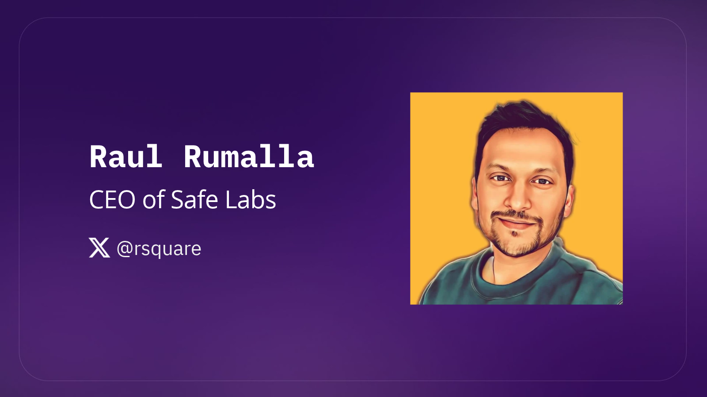
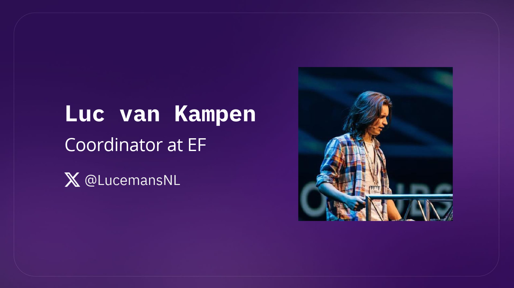
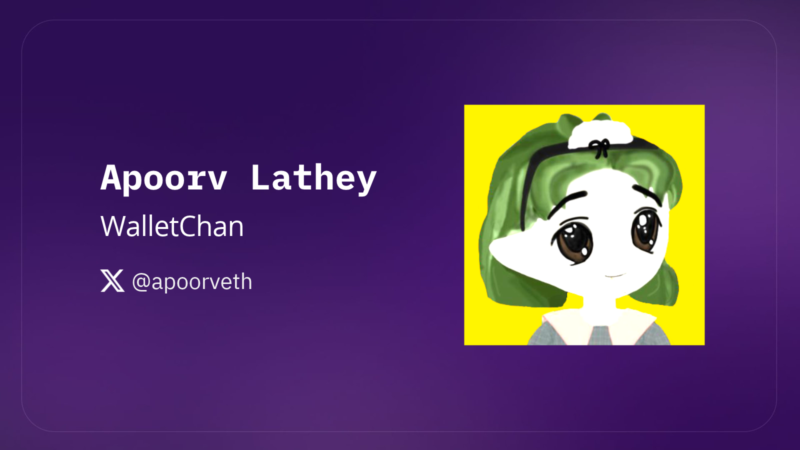
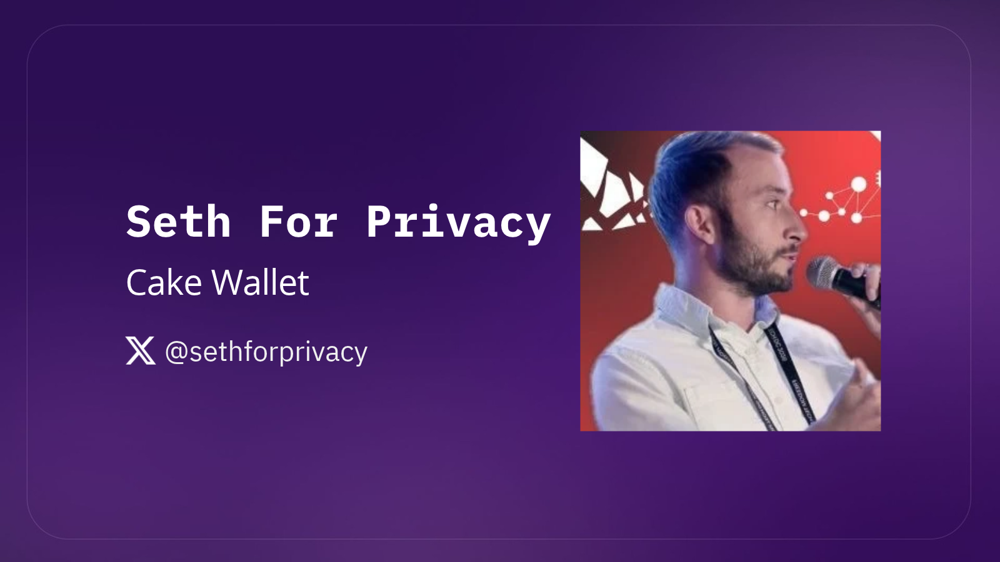
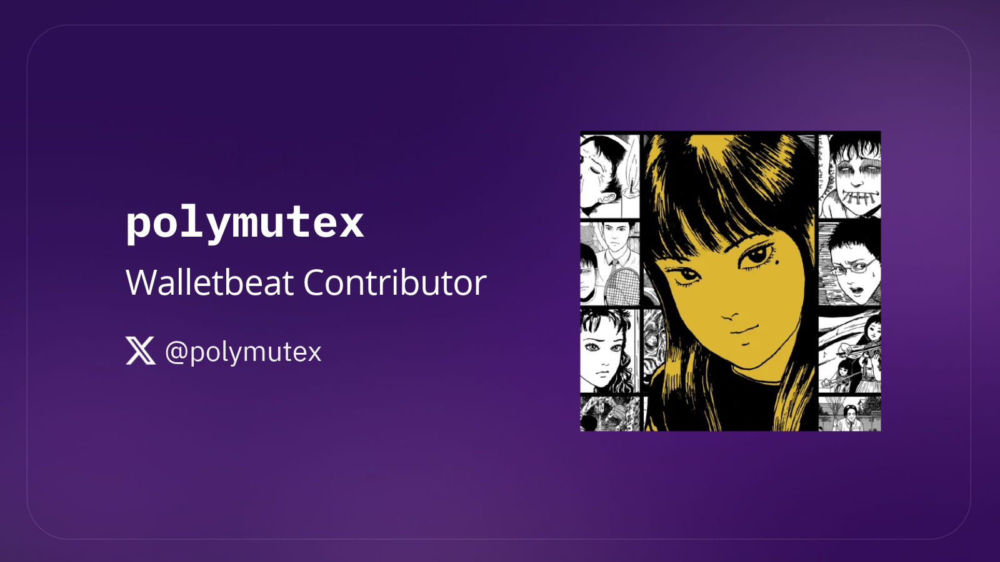

The Cypherpunk Congress by @web3privacy is happening at Mumbai, as part of @EFDevcon week

Walletbeat is curating and moderating the panel "Privacy's last-mile problem: Wallets" 👇

---

Privacy is finally being integrated in web3 wallets. 

It's a long road, and there are many practical hurdles left to solve. 

In this panel, we'll discuss what several wallets are doing to solve privacy's last-mile problem. 

Meet our panelists 👇

---
@rsquare, CEO of Safe Labs, is building core self-custody infraestructure for the onchain economy.

His focus is on translating cryptographic into products that are secure by default, and usable by real organizations and real people.
 

---

@LucemansNL works on standards coordination at the Ethereum Foundation, focusing on privacy and self-sovereignty.

He's also involved in Kohaku, an initiative to help wallets improve security and privacy while minimizing reliance on trusted third parties.

---

@apoorveth is a solo developer building @WalletChan_, an open-source Ethereum wallet focused on improving UX and bringing Ethereum's CROPS values to users through their wallets. 

---

@sethforprivacy is building freedom tech as COO of @cakewallet and @radarchat.

@cakewallet is an open source, noncustodial wallet aiming to make crypto simple for users.
 

---

@polymutex will be moderating the panel 🌸

polymutex leads Walletbeat, an open source database that grades wallets based on CROPS values.

He wants to see Ethereum fulfill its cypherpunk mission. Hence, the Walletbeat revamp in 2025, with a more in-depth focus on Ethereum alignment and richer data about individual wallets.

---

Privacy is where wallets have to make the most progress. Data posted on public blockchains like Ethereum is publicly available to everyone.  

But nevertheless, it's still possible. The panel will cover from onchain privacy to network-level privacy, Tor integration, address and amount correlations, private wallet recovery, and dealing with the plethora of intermediaries learning of wallet transaction before it gets onchain.

---

The role of Walletbeat is to push the Ethereum wallet ecosystem forward, because Ethereum values only matter if users actually experience them.

https://beta.walletbeat.eth.limo/

---

Come join us at Cypherpunk Congress and bring your questions! 

See you in Mumbai!  
https://luma.com/spsnos9t?tk=hIoBC0

---

