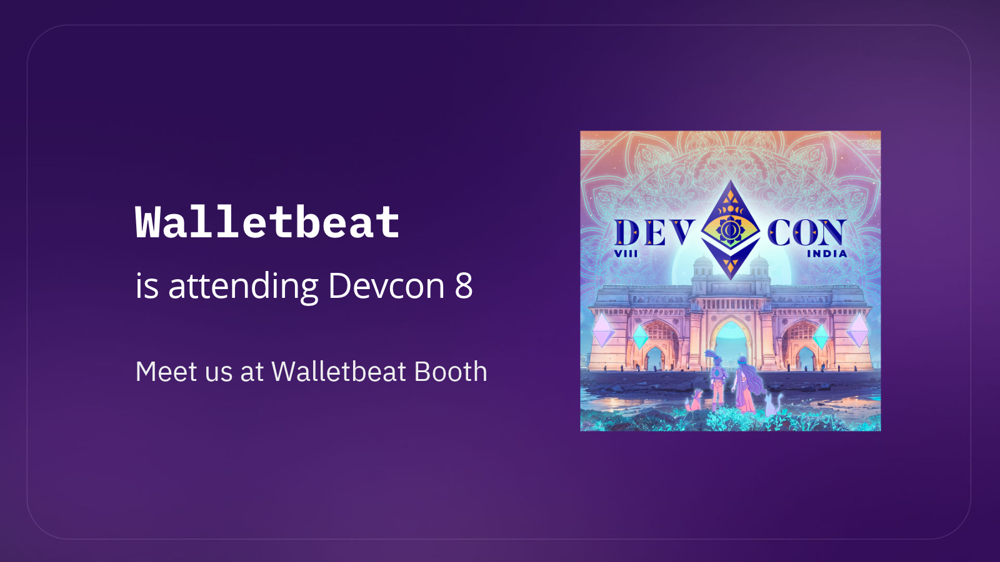

Come say hi at @EFDevcon Mumbai!

The team will be on our booth on Level 3 doing a bunch of value-first activities.

Here’s what’s on 🧵

---
Clear signing demos on hardware wallets

- Sign a real transaction on @Trezor, @FreedomFactory PQ1 and @wedgiedev and see what your device actually shows: human-readable intent instead of opaque hex.
- Demos on how to assemble hardware wallets, using the wedgie device.
- Calldata trivia: decode real transactions before you sign.

---

Understand how Walletbeat works

- Playground + website demos: see how we rate wallets on CROPS values
- Data entry workshop replay: for anyone who wants to fill in wallet data
 
---

Complain about your wallets

Recurring complaints become criteria, and criteria are how wallets get better.

Tell us which wallet you use and what you wish it did better. You can also share your complaints and rants with us on video!

---

@polymutex, @0xMattmatt, @darryl__yeo and @lucilajuliana will be there. 

See you in Mumbai 🫡
