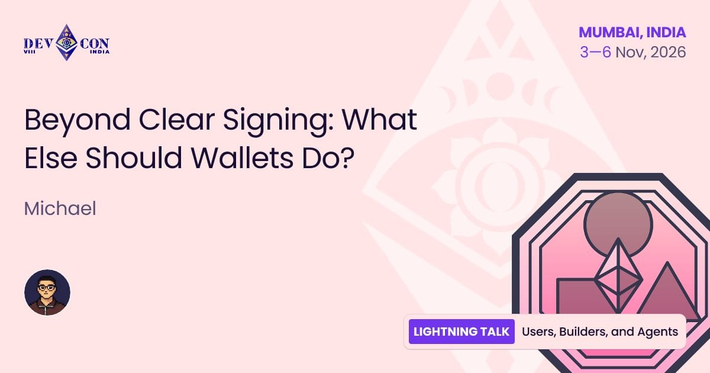
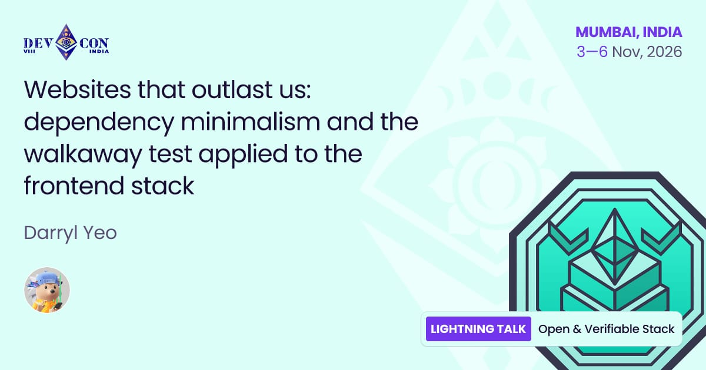
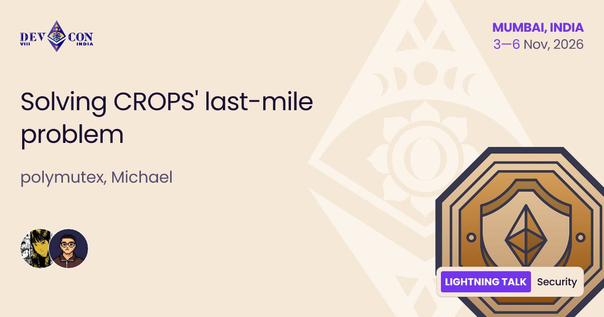
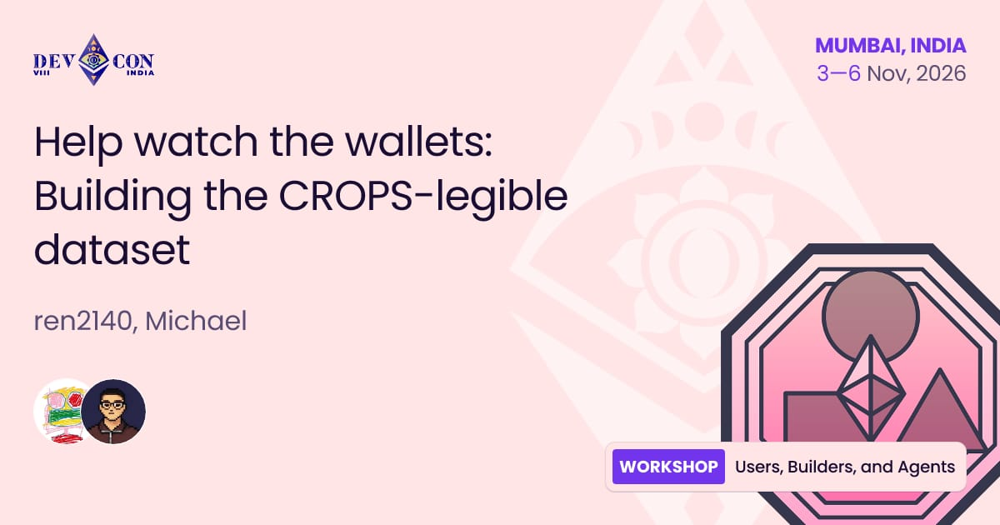

Meet the Walletbeat team in @EFDevcon!

We’re taking the stage at several tracks! Here’s where you can find us 👇 

---

➡️ Beyond Clear Signing: What Else Should Wallets Do? by @0xmattmatt

🗓️ Wed, Nov 4
⌚ 15:30 – 15:37
📍 Lightning Talk - Jasmine Stage 4

https://app.devcon.org/schedule/beyond-clear-signing-what-else-should-wallets-do

---

➡️ Wallets and software supply chain security by @polymutex

🗓️ Wed, Nov 4
⌚ 15:30 – 15:37
📍 Lightning Stage

https://app.devcon.org/schedule/wallets-and-software-supply-chain-security

---

➡️ Websites that outlast us: dependency minimalism and the walkaway test applied to the frontend stack by @darryl__yeo

🗓️ Wed, Nov 4
⌚ 16:10 – 16:17
📍 Lightning Stage

https://app.devcon.org/schedule/websites-that-outlast-us-dependency-minimalism-and-the-walkaway-test-applied-to-the-frontend-stack

---

➡️ Solving CROPS' last-mile problem by @polymutex & @0xmattmatt

🗓️ Fri, Nov 6
⌚ 10:40 – 10:47
📍 Lightning Stage

https://app.devcon.org/schedule/solving-crops-last-mile-problem

---

➡️ Help watch the wallets: Building the CROPS-legible dataset by @0xmattmatt

🗓️ Fri, Nov 6
⌚ 14:15 - 15:15
📍 Workshop 2

https://app.devcon.org/schedule/help-watch-the-wallets-building-the-crops-legible-dataset

---

Walletbeat is an open source database that grades wallets based on CROPS values.

Help watch the wallets! 🫡 

See you in @EFDevcon
https://beta.walletbeat.eth.limo/
