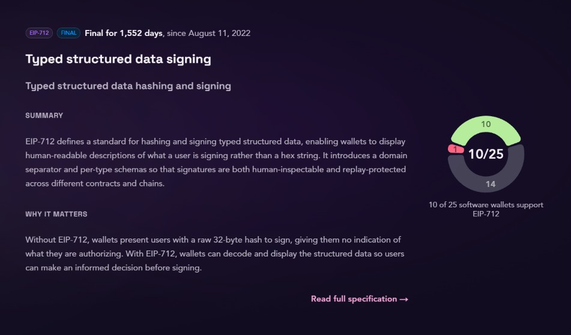
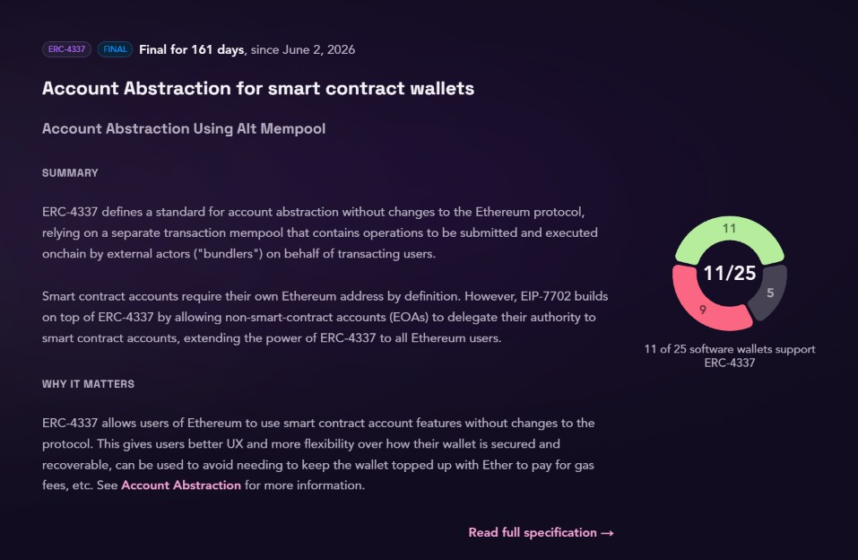
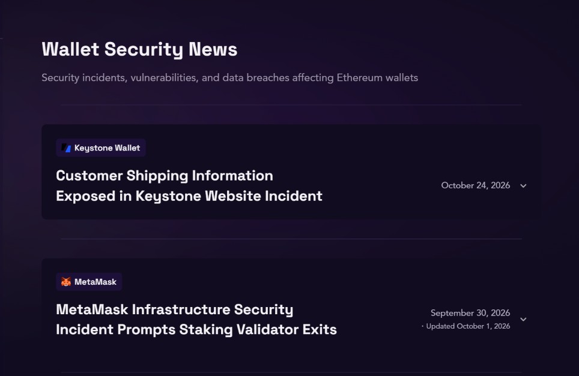
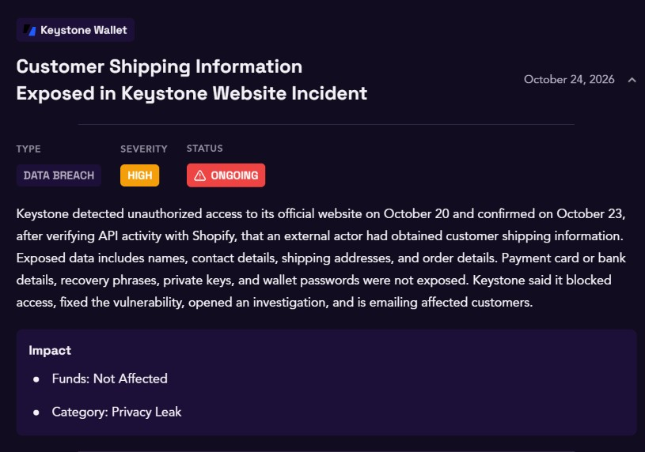
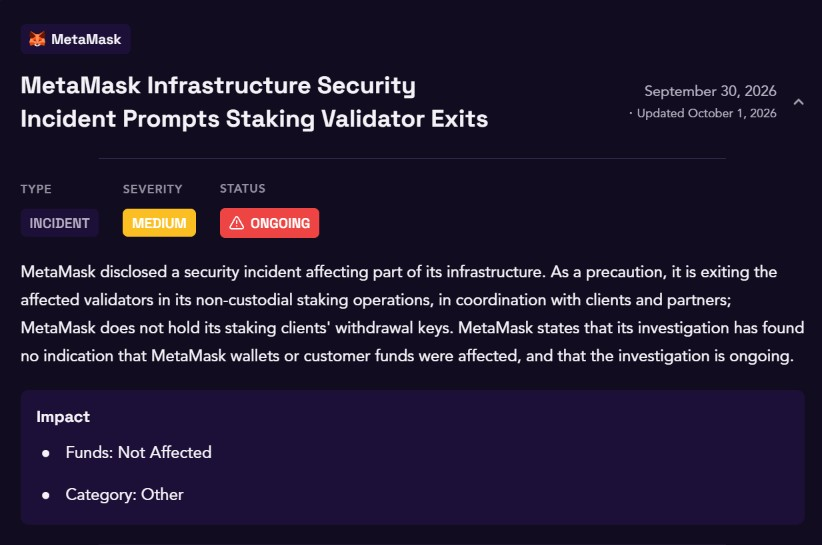

Walletbeat monthly update is here! 🌸

Check out what happened across Walletbeat and the wallet ecosystem through October 👇

---

We published our breakdown of @ambire's ratings: what's strong, what could be better, and where the gaps are.

The Ambire team responded. They added transaction simulation for ERC-721 transfers and hardened their browser extension by blocking other extensions from connecting to it.

https://x.com/walletbeat/status/2113699746070299093
https://x.com/ambire/status/2115633972189315404
https://x.com/0xSuperKalo/status/2115757525517717577

---

The Wallet Stages page got a redesign: one card per stage.

Stages describe the milestones Ethereum wallets should work toward. Each stage builds on the previous one, forming a roadmap for wallet teams to follow.

https://beta.walletbeat.eth.limo/stages/
https://x.com/walletbeat/status/2108607083860144280

---

We broke down how Walletbeat evaluates self-sovereignty and why each attribute matters:

L1 provider independence, account portability, account unruggability, transaction inclusion, and permissions management.

And the philosophy behind all our ratings: align wallets with Ethereum's values. Security, Privacy, Self-sovereignty, Transparency, Ecosystem Direction.

https://x.com/walletbeat/status/2109081324913082735
https://x.com/walletbeat/status/2109464589813567974

---

Three new wallets joined the database 👇

@TrustWallet (browser extension and mobile)
@WalletChan_
@anondotinc Wallet

---

@TrustWallet is a self-custody crypto wallet available as a mobile app and browser extension. It is backed by @binance.    
https://walletbeat.eth.limo/trust-wallet/

---

@WalletChan_, made by the solo developer @apoorveth, is an open-source Ethereum wallet focused on improving UX and bringing Ethereum's CROPS values to users through their wallets.
 
https://walletbeat.eth.limo/walletchan/

---

@anondotinc Wallet is a Railgun-based private wallet.
https://walletbeat.eth.limo/anon-wallet/

---

@CoinbaseWallet (previously Base App) also got its browser extension variant.
https://walletbeat.eth.limo/base-app/

---

Who learns what when you use your wallet?

We captured and analyzed real network traffic from the browser extensions of @MetaMask, @Rabby_io, @rainbowdotme, @Uniswap Wallet, and @ambire during onboarding, ETH and USDC transfers, swaps, app connections, and transactions.

https://github.com/walletbeat/walletbeat/tree/master/data/software-wallets/collection

---

We added a new data point: the Dependency Age Gate. 

If a dependency gets compromised, a wallet that adopts every release the moment it's published has no time to find out. 

An age gate sets a minimum age a release must reach before routine updates adopt it, so a bad release can be caught and pulled first. 

---

Also on supply chain security: dependency sandboxing is now filled in for four wallets.

Does the wallet isolate its dependencies from each other and from its own code at runtime, so a compromised dependency can't reach beyond what its policy grants?

It is supported on Ambire and unsupported on Uniswap Wallet, Rabby, and Zerion's extension.

---

The EIP tracker got a big upgrade.

Each EIP now shows how many days it has been final, and a support breakdown pie. Cards are sorted by earliest evidence of support.

https://walletbeat.eth.limo/wallet-eips/

---

Walletbeat in the wild:

@casberi_app now uses Walletbeat's evaluation framework and stage system for its wallet roadmap.

https://x.com/alexanderchopan/status/2114440976450326966

---

Everything we do is in the open, including funding:

We published our @thedaofund initiative on clear signing: ratings, fixes, and ecosystem adoption for hardware and software wallets.

https://initiatives.thedao.fund/initiative/clear-signing-ratings-fixes-and-ecosystem-adoption-for-hardw

---

Security incidents we've been tracking this month:

Keystone confirmed an external actor obtained customer shipping information through its website. No card details, recovery phrases, or private keys were exposed.

MetaMask disclosed an infrastructure incident and is exiting affected staking validators. It found no indication that wallets or funds were affected. 

https://beta.walletbeat.eth.limo/news/

---

Devcon prep took over the second half of the month.

We prepared our talks, our booth programming, the panel on privacy's last-mile problem, and more! 

https://x.com/walletbeat/status/2115851446381957211

---

October in short: we broke down Ambire’s ratings, redesigned Wallet Stages' page, onboarded new wallets, captured real wallet network traffic, and added new supply chain security data, all while getting ready for @EFDevcon.

We keep watching 🫡

Until next month! 🌸
