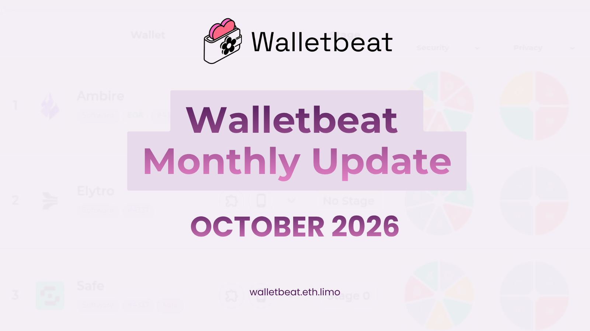

Walletbeat monthly update is here! 🌸

Check out what happened across Walletbeat and the wallet ecosystem through October 👇

---

We published our breakdown of Ambire's ratings: what's strong, what could be better, and where the gaps are.

The Ambire team reacted. They added transaction simulation for ERC-721 transfers, and committed to hardening their browser extension by blocking other extensions from connecting to it.

https://x.com/walletbeat/status/2113699746070299093 
https://x.com/ambire/status/2115633972189315404 
https://x.com/0xSuperKalo/status/2115757525517717577

---

The Wallet Stages page got a redesign: one card per stage.

Stages describe the milestones Ethereum wallets should work toward. Each stage builds on the previous, forming a roadmap for wallet teams to follow.

https://beta.walletbeat.eth.limo/stages/
https://x.com/walletbeat/status/2108607083860144280

---

We broke down how Walletbeat evaluates self-sovereignty, and why each attribute matters:

L1 provider independence, account portability, account unruggability, transaction inclusion, and permissions management.

And the philosophy behind all our ratings: align wallets with Ethereum's values. Security, Privacy, Self-sovereignty, Transparency, Ecosystem Direction.

https://x.com/walletbeat/status/2109081324913082735 
https://x.com/walletbeat/status/2109464589813567974

---

Three new wallets joined the database: Trust Wallet (browser extension and mobile), @WalletChan_, and Anon Wallet, a Railgun-based private wallet.

Base App also got its browser extension variant.

https://beta.walletbeat.eth.limo/trust-wallet/ 
https://beta.walletbeat.eth.limo/walletchan/ 
https://beta.walletbeat.eth.limo/anon-wallet/

---

Who learns what when you use your wallet?

We captured real network traffic from the browser extensions of MetaMask, Rabby, Rainbow, Uniswap Wallet and Ambire: onboarding, sending ETH and USDC, swaps, dapp connections and transactions.

We also started analyzing how those requests can be correlated back to your address and IP.

https://github.com/walletbeat/walletbeat/tree/master/data/software-wallets/collection

---

Wallets and software supply chain security:

We added a new data point, the Dependency Age Gate: do routine updates only adopt dependency releases that are a minimum age?

Dependency sandboxing is now filled in too: supported on Ambire, not supported on Uniswap Wallet, Rabby and Zerion's extension.

---

The EIP tracker got a big upgrade.

Each EIP now shows the wallets implementing it, how many days it has been final, a support breakdown pie, and cards are sorted by earliest evidence of support.

https://beta.walletbeat.eth.limo/wallet-eips/

---

Website updates:

- Preview images for every wallet page
- Lots of performance work
https://walletbeat.eth.limo/

---
Walletbeat in the wild:

@casberi_app now uses Walletbeat's evaluation framework and stage system for its wallet roadmap.

https://x.com/alexanderchopan/status/2114440976450326966

---

Everything we do is in the open, including funding:

We drafted our TheDAO Security Fund initiative on clear signing: ratings, fixes, and ecosystem adoption for hardware and software wallets. And the Ethereum Foundation awarded us a grant, paid in ETH per milestone through January 2027.

https://initiatives.thedao.fund/initiative/clear-signing-ratings-fixes-and-ecosystem-adoption-for-hardw
https://beta.walletbeat.eth.limo/governance/grants/2026-08-ethereum-foundation-esp-grant-proposal/

---

Wallet security news:

MetaMask disclosed an infrastructure incident and is exiting affected staking validators. It found no indication that wallets or funds were affected. Still investigating.

https://x.com/MetaMask/status/2105442300335620460

---

Keystone confirmed an external actor obtained customer shipping information through its website. No card details, recovery phrases, or private keys were exposed.

https://x.com/KeystoneWallet/status/2114054080754770137

Want the full breakdown? https://beta.walletbeat.eth.limo/news/

---

Devcon prep took over the second half of the month.

We announced our talks, our contributor workshop, our booth, the Cypherpunk Congress panel on privacy's last-mile problem, and the Wallet & Transaction Security roundtable at the Ethereum Forward Defence Summit.

https://x.com/walletbeat/status/2114847240002933005 
https://x.com/walletbeat/status/2116181349140979995 
https://x.com/walletbeat/status/2115851446381957211

---

Wallets are one of the most critical layers of the crypto ecosystem. We keep watching 🫡

Until next month! 🌸

