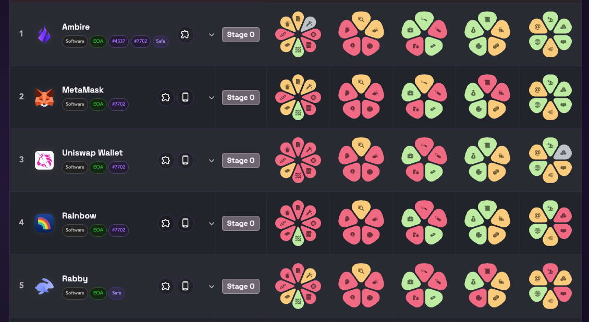

Walletbeat now has its first five fully rated wallets.

Ambire, MetaMask, Uniswap Wallet, Rainbow, and Rabby have complete coverage across every applicable attribute we evaluate.

Here is what that milestone means 🧵

---

Fully rated: @ambire, @MetaMask, @Uniswap, @rainbowdotme, and @Rabby_io.

Fully rated does not mean perfect. It means every applicable attribute has a published rating, not that every attribute passes.

---

A wallet can still fail individual attributes and remain fully rated.

What changes is that there are no unrated gaps left to hide the full picture.

---

These five wallets now have complete profiles across security, privacy, transparency, ecosystem alignment, and self-sovereignty.

That gives users a fair comparison and gives wallet teams a concrete list of what to improve.

---

Why does full coverage matter?

A missing rating is not neutral. It can hide a strong protection or a serious gap, and it makes rankings less trustworthy.

Complete data turns a wallet profile into something users can actually act on.

---

Reaching this point took a lot of evidence collection and review. Thanks to the wallet teams and contributors who helped complete these profiles.

Explore the fully rated wallets:
https://beta.walletbeat.eth.limo/

---

Walletbeat's goal is to make CROPS legible for every wallet, not just these five.

More wallets are being filled in. Walletbeat is open source, and anyone can help complete the next profile.

https://beta.walletbeat.eth.limo/about/
https://github.com/walletbeat/walletbeat
