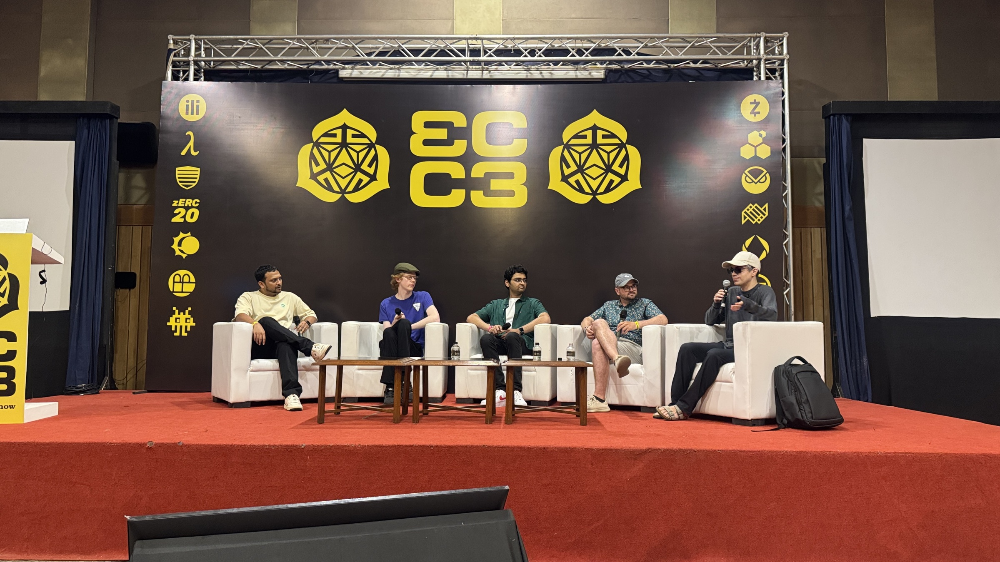
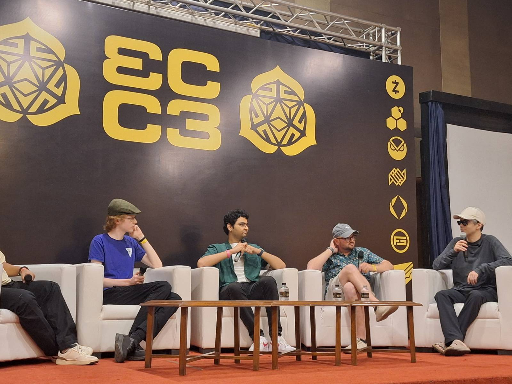
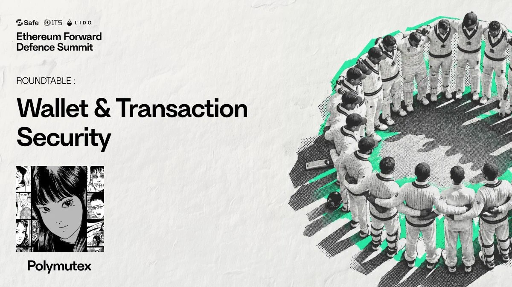
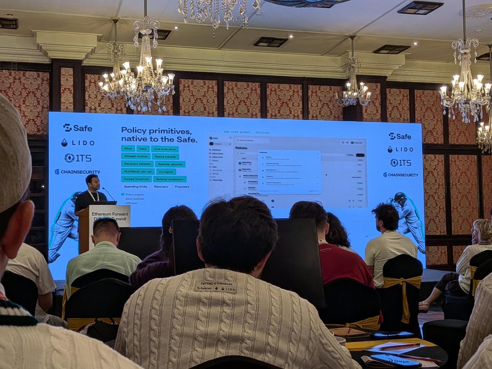
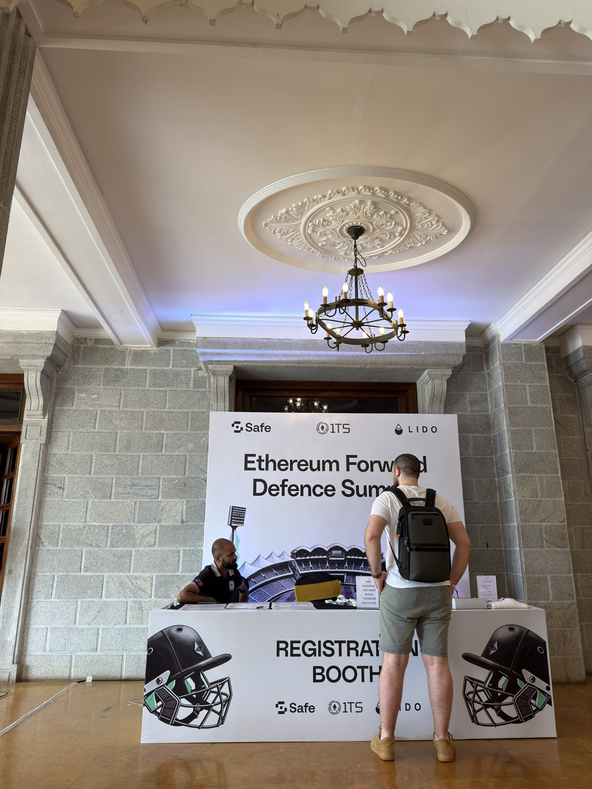
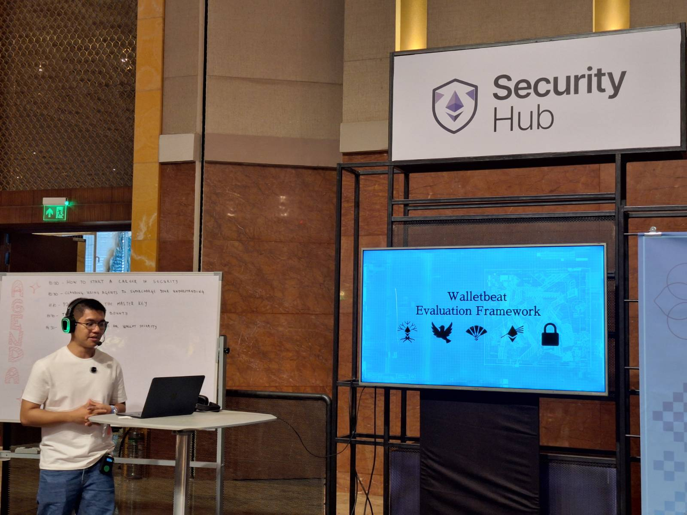
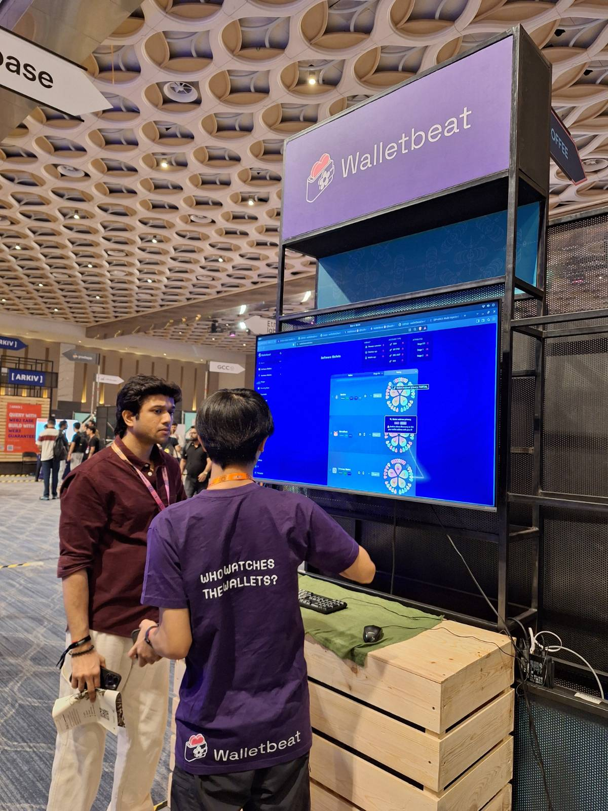
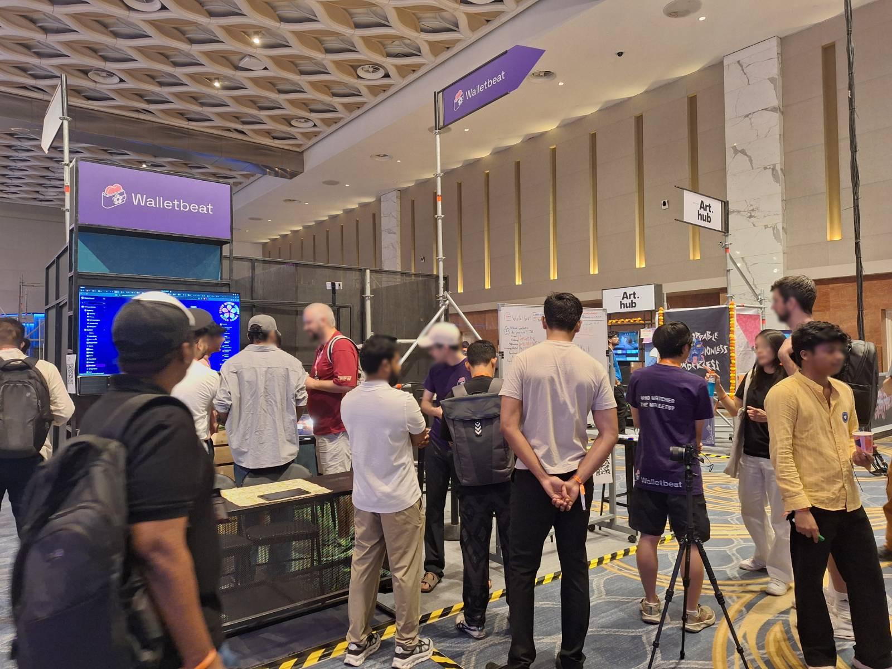

We took Walletbeat to @EFDevcon Week 🌸
Talks, workshops, panels, and our very own booth. Here's our recap 🧵👇

[ATTACHED VIDEO COMES HERE]

---

@polymutex curated and moderated the panel "Privacy's last-mile problem: Wallets" at the Cypherpunk Congress

Privacy is finally being integrated in web3 wallets. It's a long road, and there are many practical hurdles left to solve. 

We discussed what several wallets are doing to solve privacy's last-mile problem. 

https://x.com/polymutex/status/2117276278931808512

---

Ethereum Forward Defence Summit, organized by @safe

@polymutex and @0xMattmatt led the “Wallet & Transaction Security” roundtable.

This event brought together a curated room of top leaders and important voices discussing Ethereum security roadmaps and standards.

https://x.com/safe/status/2117635068252565901

---

Beyond Clear Signing: What Else Should Wallets Do?

@0xmattmatt took the stage at @EFDevcon and covered clear signing, scam alerting, transaction simulation, and enforceable transaction constraints.

https://x.com/walletbeat/status/2117963078637932582
https://youtu.be/3olBJDDRp7E?si=vsygBmrKLVEtr3D2

---
The only things worth building are the ones that keep working after everyone walks away.

@darryl__yeo explored "Websites that outlast us: dependency minimalism and the walkaway test applied to the frontend stack."

https://x.com/walletbeat/status/2118221421893873772
https://youtu.be/O7D1ZjTLACw?si=a3LtybnLLe0_mMYs

---

@polymutex explored how should wallets protect against software supply chain attacks.

He covered existing measures for software supply chain integrity, their underlying concepts, why they are important, and how to implement these processes in your wallet's software development process.

https://x.com/walletbeat/status/2118305509241655722
https://youtu.be/v2r2BrANXo8?si=QS11OBJ8DBxT7Bh2

---

@polymutex took the stage at @EFDevcon with "Solving CROPS' last-mile problem".

This talk walked through what obstacles exist for wallets to fully embody Ethereum values, and how "dashboard organizations" like Walletbeat fit in solving the last-mile problem at the access layer.

https://x.com/walletbeat/status/2118658629431943376
https://youtu.be/qP0u2WPQjs8?si=DcHsx_vcUrQMqINs

---

Workshop "Help watch the wallets: Building the CROPS-legible dataset"

@0xMattmatt showed how to contribute one wallet attribute end to end, with the help of AI and a human in the loop for verification. He shared best practices for capturing evidence, write the entry and open the PR.
 
https://x.com/walletbeat/status/2118664152504009178

---

Why Everything Matters for Wallet Security by @0xMattmatt

Matt took the stage at the Security Hub and shared why privacy, self-sovereignty, transparency, and ecosystem alignment matter for wallet security, and how getting one wrong can put users at risk.

 
---

Last but not least, the Walletbeat booth was very packed during the whole conference. It was very rewarding to engage with the community and spread the word about our mission. 

We shared how wallets get rated, what the data means, and what wallets have changed because of it 🌸

We also had a Wallet Complaints Whiteboard and interviewed a lot of users. Clips coming soon!

---

That's a wrap on @EFDevcon week 🌸

Panel on privacy's last-mile problem. Forward Defence Summit roundtable. Talks on clear signing, walkaway-proof frontends, supply chain security and CROPS. A workshop to build the CROPS-legible dataset. A Security Hub session. And a packed booth.

One mission: improve the wallet ecosystem through open, transparent, and evidence-based evaluations. Pushing CROPS to wallets, we ensure Ethereum values make it all the way to users.

---

Thank you so much to the @EFDevcon organizers for selecting Walletbeat as an Impact Project. 

