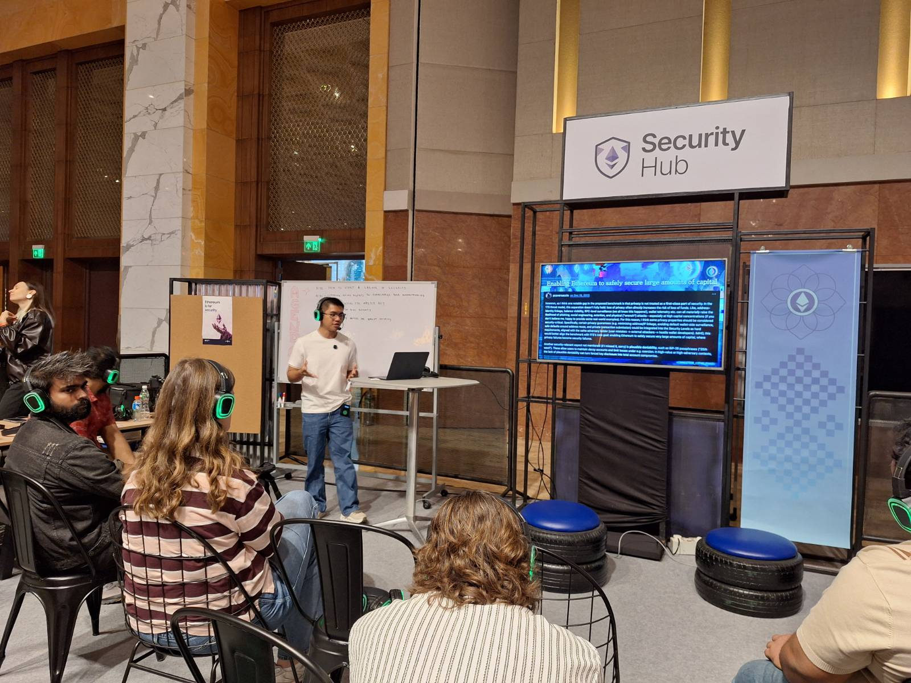
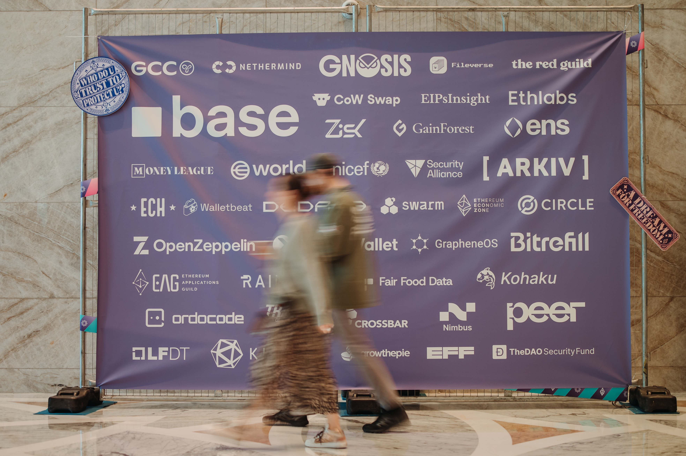
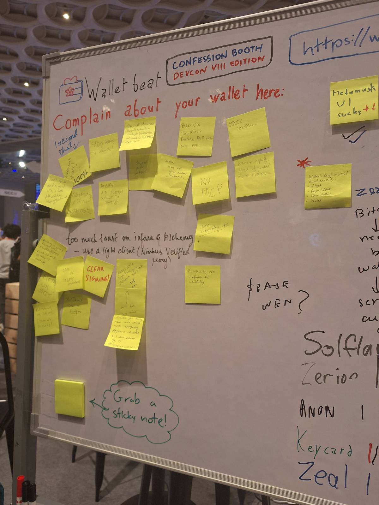
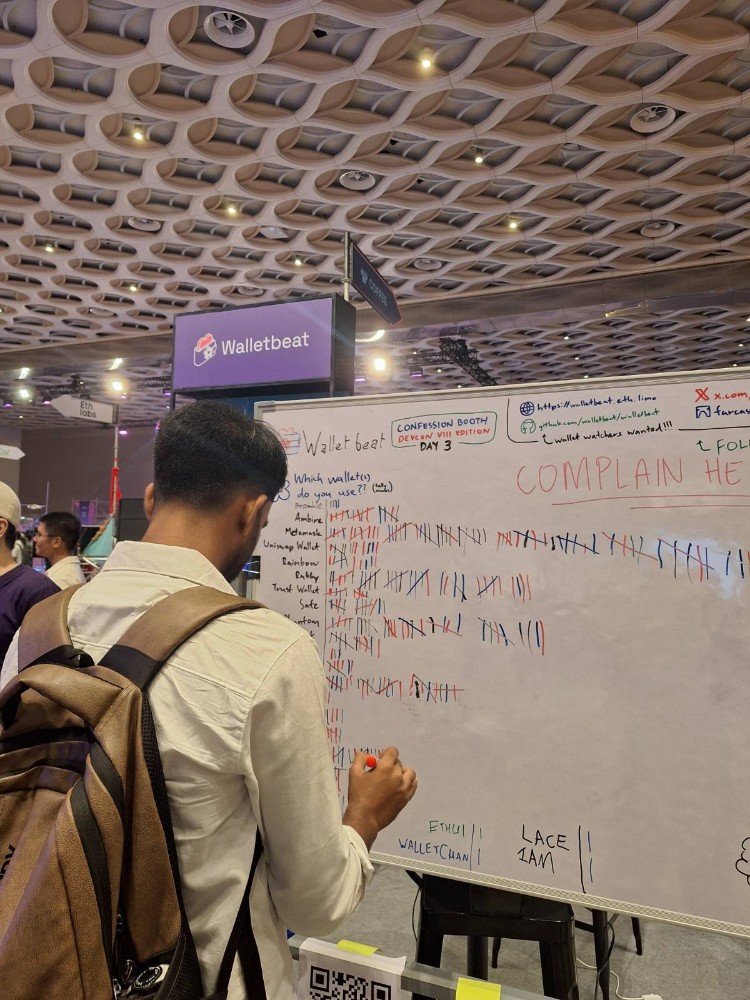
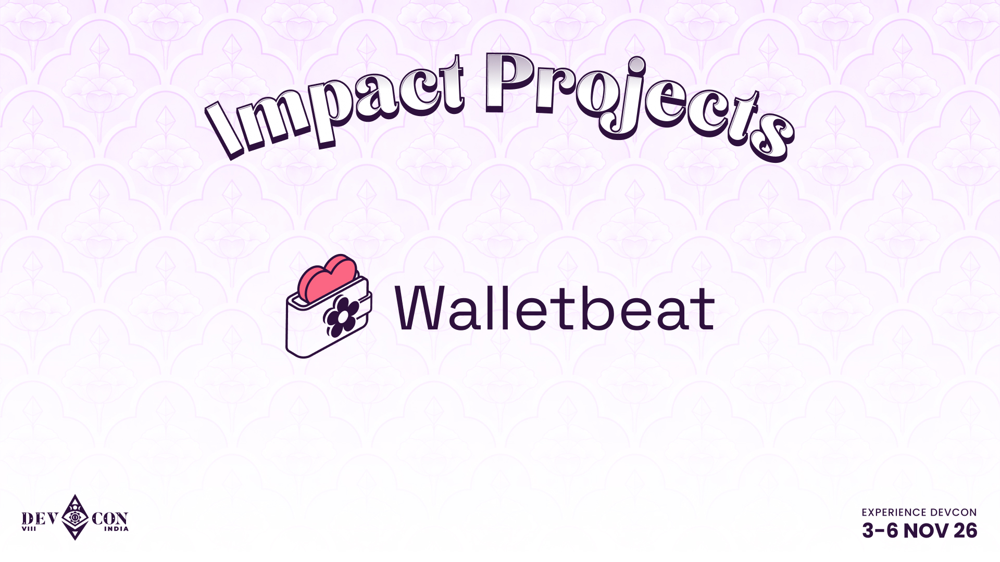

We took Walletbeat to @EFDevcon Week 🌸
Talks, workshops, panels, and our own booth. Here's our recap 🧵👇

[ATTACHED VIDEO COMES HERE]

---

Cypherpunk Congress, organized by @web3privacy

@polymutex moderated the panel "Privacy's last-mile problem: Wallets"

https://x.com/polymutex/status/2117276278931808512

---

Ethereum Forward Defence Summit, organized by @safe

@polymutex and @0xMattmatt led the “Wallet & Transaction Security” roundtable.

This event brought together a curated room of top leaders and important voices discussing Ethereum security roadmaps and standards.

https://x.com/safe/status/2117635068252565901

---

Beyond Clear Signing: What Else Should Wallets Do?

@0xmattmatt took the stage at @EFDevcon and covered clear signing, scam alerting, transaction simulation, and enforceable transaction constraints.

https://x.com/walletbeat/status/2117963078637932582
https://youtu.be/3olBJDDRp7E?si=vsygBmrKLVEtr3D2

---
The only things worth building are the ones that keep working after everyone walks away.

@darryl__yeo explored "Websites that outlast us: dependency minimalism and the walkaway test applied to the frontend stack."

https://x.com/walletbeat/status/2118221421893873772
https://youtu.be/O7D1ZjTLACw?si=a3LtybnLLe0_mMYs

---

@polymutex covered how should wallets protect against software supply chain attacks
https://x.com/walletbeat/status/2118305509241655722

---

The last day of @EFDevcon, @polymutex took the stage with "Solving CROPS' last-mile problem".

https://x.com/walletbeat/status/2118658629431943376
https://youtu.be/qP0u2WPQjs8?si=DcHsx_vcUrQMqINs

---

Workshop "Help watch the wallets: Building the CROPS-legible dataset"

@0xMattmatt showed how to contribute one wallet attribute end to end, with the help of AI and a human in the loop for verification. He shared best practices for capturing evidence, write the entry and open the PR.
 
https://x.com/walletbeat/status/2118664152504009178

---

Why Everything Matters for Wallet Security by @0xMattmatt

Matt took the stage at the Security Hub and shared why privacy, self-sovereignty, transparency, and ecosystem alignment matter for wallet security, and how getting one wrong can put users at risk.

 
---

Last but not least, our booth was very packed during the whole conference. It was very rewarding to engage with the community and spread the word about our mission. 

We shared how wallets get rated, what the data means, and what wallets have changed because of it 🌸

---

Thank you so much to the @EFDevcon organizers for selecting Walletbeat as an Impact Project. 

