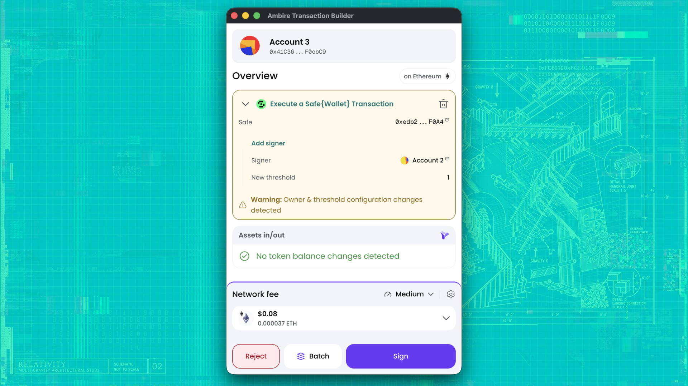
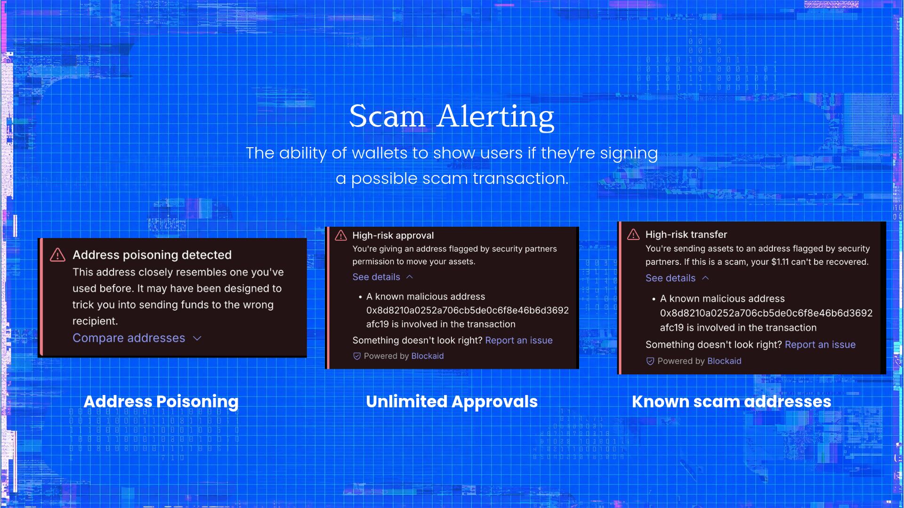
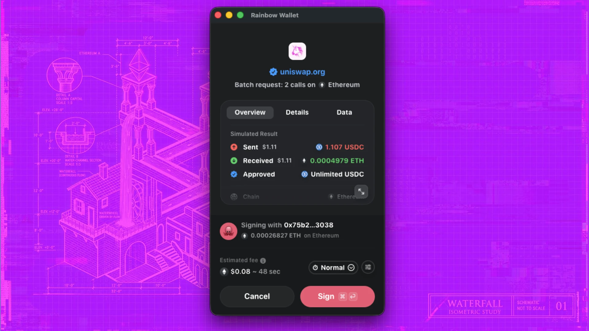
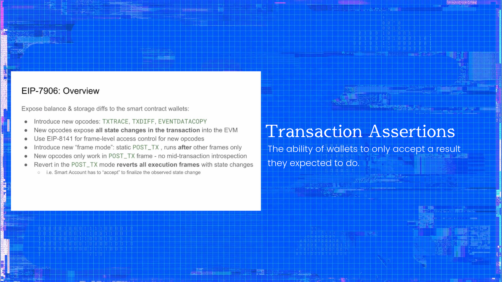
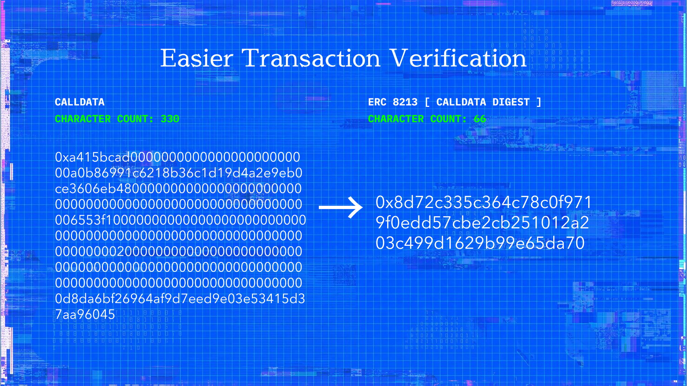

Is understanding your transactions enough or should your wallets do more to protect you?

In this @EFDevcon talk, @0xMattmatt talks about 4 things wallets should do beyond Clear Signing 👇

https://youtu.be/3olBJDDRp7E?si=EFwX9oDay6O5Ssbn

---

Clear signing 

Wallets show human readable transactions instead of hexadecimal data. 

For example, this is a safe wallet transaction with clear signing. You can clearly understand what you're about to do. 

---

1. Scam alerting 

Wallets warn users if they're signing a possible scam transaction. Your wallet should flag these types of scams 👇
- Address poisoning
- Unlimited token approvals
- Known scam addresses

---

2. Transaction simulation

Wallets preview the result of a transaction. 

The catch is that it simulates what might happen, not what will happen. 

For example, when doing swaps, a sandwich attack can still give you the worst price.

---

3. Transaction assertions

The wallet sets conditions on what a transaction can do. And if those conditions are not met, the transaction reverts. 

It is still in research 👇

---

4. Easier hardware wallet transaction verification 

Today we're used to check pages of hexadecimal data and hope we didn't make a single mistake. 

But with ERC-8213, a call data digest compresses all of it into a single 32-byte digest.

---

The problem: wallets usually ship one of these, not all of them. While all of these are available, that won't matter if they don't land on wallets.

If you're a wallet developer, implement this. If you're a wallet user, ask for this.
 
---

That's where Walletbeat comes in. 

Walletbeat rates wallets on privacy, security, transparency, self-sovereignty, and ecosystem alignment.

We give wallets actionable feedback to improve.

https://walletbeat.eth.limo/

---

@0xMattmatt is a Walletbeat core contributor. He focuses on wallet attributes research and pushing CROPS values into Ethereum's access layer.

