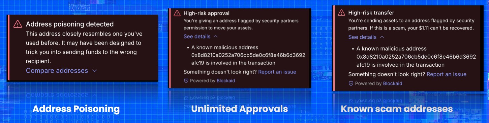
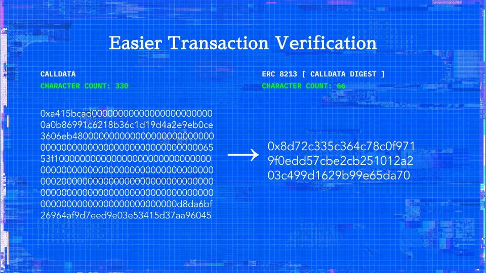
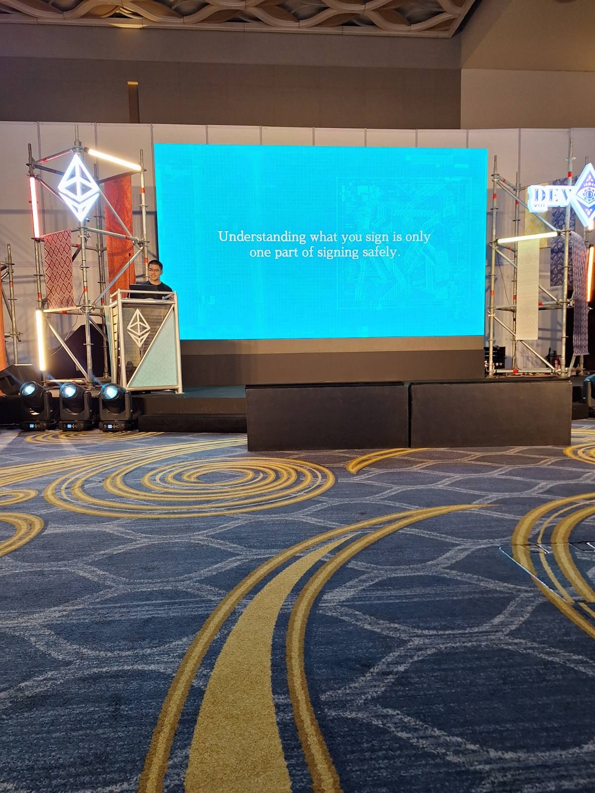

Is understanding your transactions enough or should your wallets do more to protect you?

In this @EFDevcon talk, @0xMattmatt talks about what should wallets do, beyond Clear Signing 👇

https://youtu.be/3olBJDDRp7E?si=EFwX9oDay6O5Ssbn

---

Clear signing is an important step toward safer wallet interactions, but it's only one piece of the puzzle.

This talk looks at other ways wallets can protect user intent: from scam alerting and transaction simulation, to emerging work on enforceable transaction constraints. 

If you're a wallet developer, implement this. If you're a wallet user, ask for this 👇

---

Scam Alerting is the ability of wallets to show users if they're signing a possible scam transaction. Your wallet should flag these types of transactions 👇

---

Clear Signing is the ability of wallets to show human readable transactions. For example, this is a safe wallet transaction with clear signing. 

---

Transaction simulations is the ability of wallets to simulate the result of a transaction. 

The thing about transaction simulation is that it simulates what might happen and not what will happen. 

For example, when doing swaps, you can still get the worst price from a sandwich attack. 

---

This is where transaction assertions come in. 

They let wallets set condition on what a transaction can do. 

And if those conditions are not met, the transaction reverts.

---

And lastly, another thing that wallets can do is make hardware wallet transaction verification easier.

What we're used to currently is verifying pages of hexadimal data and hope that we don't make a single mistake. 

And thanks to ERC-8213, call data digest compresses pages of hexodimal data into a single 32-byte digest.

---
The problem is wallets typically don't implement this altogether. They implement one but not the other. This is where Walletbeat comes in. 

We evaluate and push wallets to uphold Ethereum values such as privacy, security, transparency, self-sovereignity, and ecosystem alignment.

We give wallets actionable feedback and push them to improve.

https://walletbeat.eth.limo/

---

@0xMattmatt is a Walletbeat core contributor, focused on wallet attributes research and pushing CROPS values into Ethereum's access layer.

