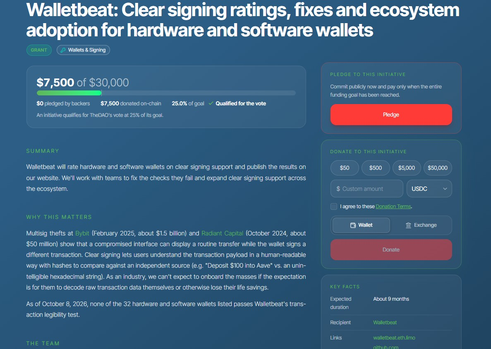

Walletbeat has been accepted into the ETHSecurity Initiatives Round!

Our initiative aims to rate hardware and software wallets on clear signing support and publish the results on our website. 

We'll work with teams to fix the checks they fail

Explore and support: https://initiatives.thedao.fund/initiative/clear-signing-ratings-fixes-and-ecosystem-adoption-for-hardw

---

The initiative is now 25% funded!

Help us bring it to 100% and expand clear signing support across the ecosystem.

Why this matters 👇

---

Clear signing lets users understand the transaction payload in a human-readable way with hashes to compare against an independent source (e.g. "Deposit $100 into Aave" vs. an unintelligible hexadecimal string). 

As an industry, we can't expect to onboard the masses if the expectation is for them to decode raw transaction data themselves or otherwise lose their life savings.

---

Our commitments:

- Clear signing ratings: readable benchmark transactions (ERC-7730), plus calldata and EIP-712 message hashes (ERC-8213).
- One device per rated hardware wallet, bought at retail (about 2,500 USD total).
- Retests of new releases, with results in the public impact log.
- Working with wallet teams to drive adoption.

---

To remain a public good, we refuse funding from wallet-related entities and disclose all contributor affiliations.

Help fund this initiative 🫡
https://initiatives.thedao.fund/initiative/clear-signing-ratings-fixes-and-ecosystem-adoption-for-hardw

---

Thank you @thedaofund for supporting security initiatives in the Ethereum ecosystem.

Walletbeat aims to raise the bar and push the wallet ecosystem forward.

https://walletbeat.eth.limo/
