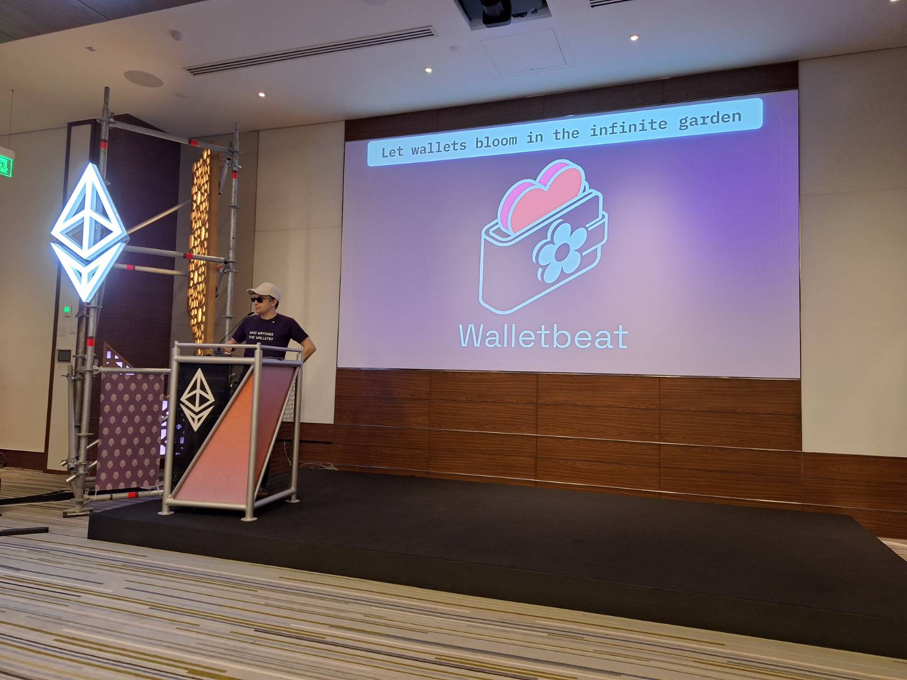

If you take anything from this talk, let it be this: If you want CROPS for users, you need CROPS in wallets.

@polymutex showed what we mean by CROPS in wallets and how wallets currently don't stack up to all these. He went through all the CROPS letters and shared what it maps to in terms of wallet features. 

Watch the full talk here 👇

---

https://youtu.be/qP0u2WPQjs8?si=RpteprItkmOGUkxV

