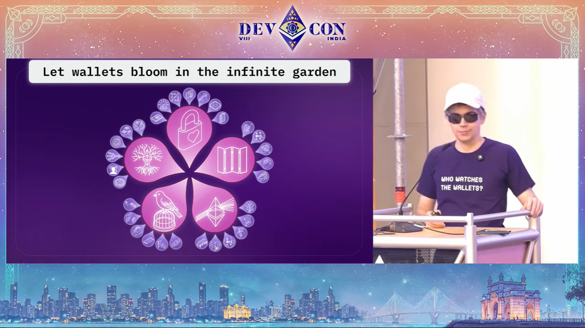
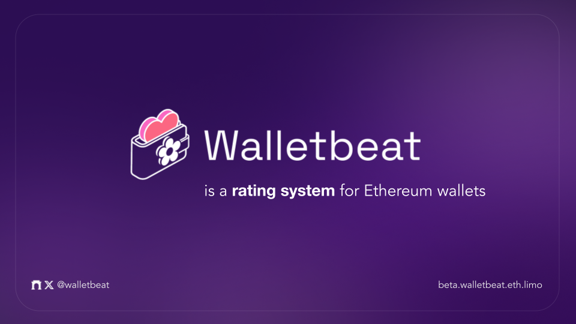
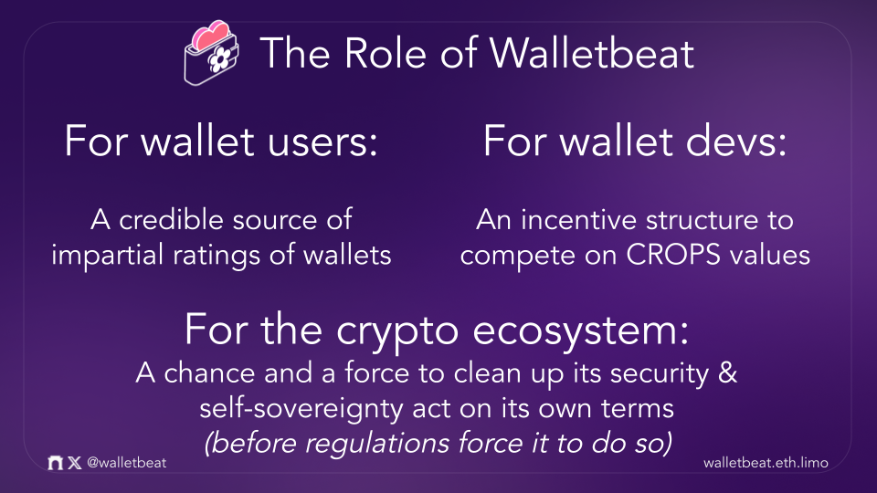
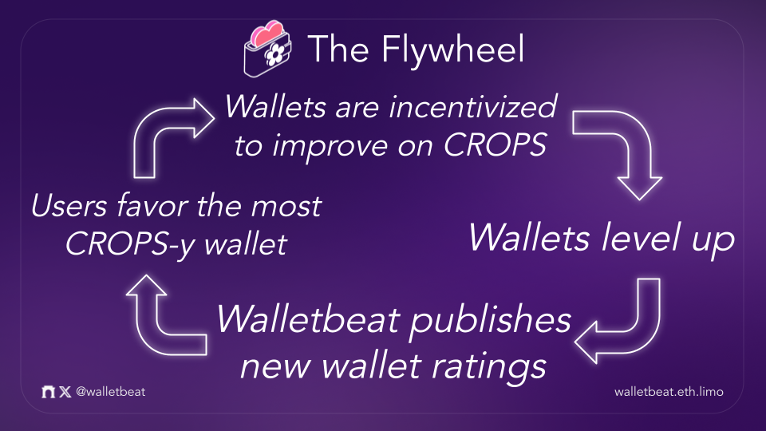
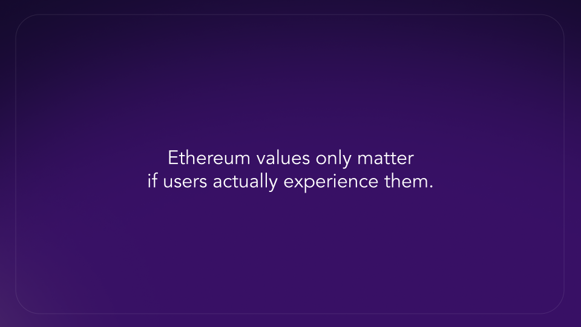

Wallets are how users use and experience Ethereum.

Doesn't matter how CROPS-y the protocol layer is: if you want CROPS for users, you need CROPS in wallets.

Pushing CROPS to wallets, we ensure Ethereum values make it all the way to users.

Watch the full talk here 👇

https://youtu.be/qP0u2WPQjs8?si=RpteprItkmOGUkxV

---

@polymutex shows what we mean by CROPS in wallets, and maps all the CROPS letters to concrete wallet features. 

No wallet meets all of them today but we're hoping to make that be more common in wallets. 

---

Walletbeat's goal is to be a rating system for Ethereum wallets. That creates three effects 🌸👇

---

1. For wallet users: you can make an informed decision about which wallet to pick, because you'll know what properties of CROPS you're getting and which ones you're not.

---

2. For wallet development teams: by having this rating system, we push wallet devs to compete on those CROPS dimensions, faster than market incentives alone would get there. 

---

3. For the ecosystem: to clean up its act on security, privacy and all the CROPS dimensions. Because if that doesn't happen and the status quo of hacks and blow-ups everywhere keeps happening, then self custody will be regulated out of existence.

---

The flywheel that Walletbeat is trying to kickstart is as follows:

- We publish wallet ratings. 
- Users can see this and make an informed decision about their wallet. 
- Wallets are incentivized to improve on their crops scores
- Ratings go up
- We publish new wallet ratings and the cycle repeats. 

---

Kickstarting this flywheel is where we need your help:

We need people to speak up and push wallets to care about what Walletbeat says about them. 

Ethereum values only matter if users actually get to experience them.

---

Walletbeat push the wallet ecosystem forward through open, transparent, and evidence-based evaluations. 

https://walletbeat.eth.limo/
