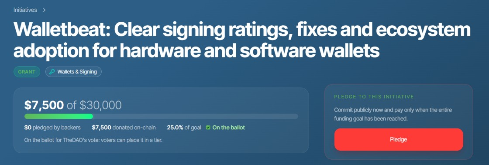

If you are an ETHSecurity Badge holder, consider supporting our initiative to rate hardware and software wallets on clear signing support and publish the results on our website. 

https://initiatives.thedao.fund/initiative/clear-signing-ratings-fixes-and-ecosystem-adoption-for-hardw

---

Why this matters 

Multisig thefts at Bybit (February 2025, about $1.5 billion) and Radiant Capital (October 2024, about $50 million) show that a compromised interface can display a routine transfer while the wallet signs a different transaction. 

---

Clear signing lets users understand the transaction payload in a human-readable way with hashes to compare against an independent source (e.g. "Deposit $100 into Aave" vs. an unintelligible hexadecimal string).

---

As of now, none of the 32 hardware and software wallets listed passes Walletbeat's transaction legibility test.

---

If you are not an ETHSecurity Badge holder, donate to this initiative!

Help us bring it to 100% funded and expand clear signing support across the ecosystem.
https://initiatives.thedao.fund/initiative/clear-signing-ratings-fixes-and-ecosystem-adoption-for-hardw

---

Thank you @thedaofund for supporting security initiatives in the Ethereum ecosystem.
