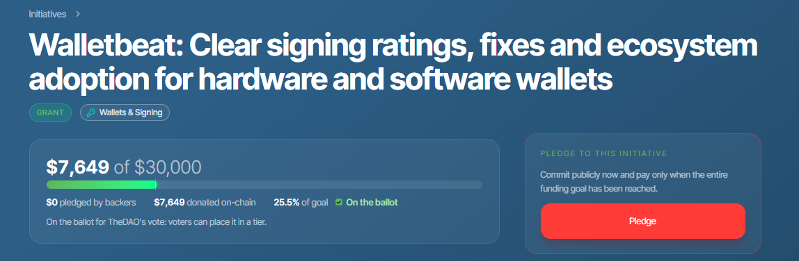

Consider supporting our initiative to rate hardware and software wallets on clear signing support and publish the results on our website. 

Any amount helps. It's all or nothing, so every donation counts toward the full $30,000.

https://initiatives.thedao.fund/initiative/clear-signing-ratings-fixes-and-ecosystem-adoption-for-hardw

---

Why this matters 

Multisig thefts at Bybit (February 2025, about $1.5 billion) and Radiant Capital (October 2024, about $50 million) show that a compromised interface can display a routine transfer while the wallet signs a different transaction. 

---

Clear signing lets users understand the transaction payload in a human-readable way with hashes to compare against an independent source (e.g. "Deposit $100 into Aave" vs. an unintelligible hexadecimal string).

As of now, none of the 32 hardware and software wallets listed passes Walletbeat's transaction legibility test.

---

Help us bring it to 100% funded and expand clear signing support across the ecosystem.

Donating takes a minute. Open the initiative page, pick an amount, choose a stablecoin, accept the terms and pay from your wallet or an exchange. Any amount helps, and individual donations count toward the $30,000 goal.

https://initiatives.thedao.fund/initiative/clear-signing-ratings-fixes-and-ecosystem-adoption-for-hardw

---

Prefer to pledge? Commit publicly now and pay only when the full funding goal is reached. Email info@thedao.fund to add your pledge. 

---

Thank you @thedaofund for backing security initiatives across Ethereum.

Every wallet should pass this test. Donate, or share this thread with someone who can. 🌸
