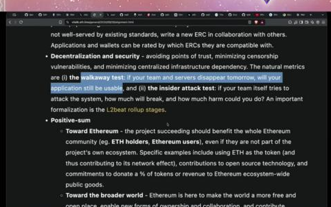

Can a website outlive the people who built it?

In this @EFDevcon talk, @darryl__yeo walks through the non-obvious tech decisions behind the Walletbeat website: dependency minimalism and the walkaway test, applied to the frontend stack 👇

https://youtu.be/O7D1ZjTLACw?si=gzQ2__jKzdXsg-Ev

---

Walletbeat rates Ethereum wallets on privacy, security, transparency, self-sovereignty, and ecosystem alignment.

Darryl's point: if we hold wallets to Ethereum values, our own site should follow the same values too.

So when Poly Mutix and I first set out to build this site two years ago, we both felt it was quite important that we apply generally the same Ethereum values and principles across every aspect of our build and publishing pipeline that powers the website. So this led us to some rather interesting and non-obvious text decisions

---

Two principles guided the stack.

1. Dependency minimalism: write software with as few dependencies as practical. More important than ever, with software supply chain attacks everywhere.

dependency minimalism. That's writing software that deliberately tries to have as few dependencies as practical. And yeah, this is more important than ever now that we have you know AI kind of hacking everything left and right and uh you know just software supply chain attacks happening uh all over the place.

---

2. The walkaway test: if the maintainers stop spending time, money, and effort on a project, does the output stay usable for the people who still rely on it?

if the maintainers stop spending time money and manpower to maintain a certain project will the website or the app stay stay meaningfully usable and accessible to people who want to keep benefiting from it. some in our industry would argue that this is actually the entire point of the industry maybe the heart and soul of it and we need to keep it live.

---

The conventional path for a site like this: React and Next.js, a database like Supabase or Postgres, Tailwind for styling, deployed to a centralized host like Vercel or Cloudflare.

It works. But every one of those choices hides assumptions and trade-offs.

but you know as with all technical decisions there's lots of hidden assumptions behind choosing any tech stack and they all come with their own set of trade-offs 

---

Wallet ratings barely change day to day. So why pay for a database, or a server that renders pages on demand?

Instead, Walletbeat: here's the decisions we made for our tech stack.
- Models wallet data as static TypeScript data structures. we chose to model everything as static data structures in Typescript. 
- Compiles the site to static files with Astro. we use a static compiler such as Astro.
- Uses Svelte for the interactive bits. for the interactive bits, we use Svelte.

---

Distribution matters just as much as the build. After evaluating dozens of options, two stood out: ENS and HTTPS gateways like eth.limo, tied together with a custom GitHub Actions pipeline.

What next? What about the dependencies we need to publish and distribute it? So yeah, polymutex evaluated dozens of possible tools and in the end two technologies stood out ENS and HTTPS gateways like E limo and yeah in the end we built our a custom GitHub actions pipeline around this.

---

If every Walletbeat maintainer walked away tomorrow, the site should keep working for the people who still want to use it. That's the test every decision had to pass.

---

Watch the full talk, then check our ratings for yourself 👇

https://walletbeat.eth.limo/

---

@darryl__yeo is a Walletbeat core contributor and the front-end dev and UI engineer behind the Walletbeat website. Before Walletbeat, he spent 5 years building interfaces at DeFi companies including dYdX and Coinbase.

