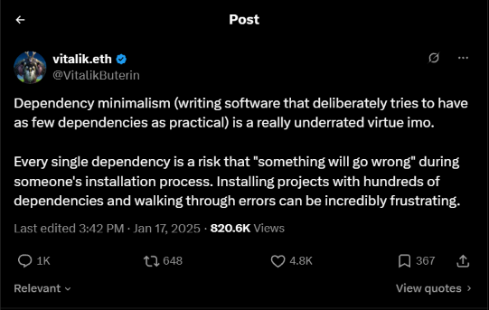

Can a website outlive the people who built it?

In this @EFDevcon talk, @darryl__yeo walks through the tech decisions behind the Walletbeat website: dependency minimalism and the walkaway test, applied to the frontend stack 👇

https://youtu.be/O7D1ZjTLACw?si=gzQ2__jKzdXsg-Ev

---

Walletbeat rates Ethereum wallets on privacy, security, transparency, self-sovereignty, and ecosystem alignment.

If we hold wallets to Ethereum values, our own site should follow the same values too.

---

So when @polymutex and @darryl__yeo first set out to build this two years ago, they felt the need to apply the same Ethereum values across the build and publishing pipeline that powers the website. 

This led us to some interesting tech decisions ⬇️

---

Two principles guided the stack.

1. Dependency minimalism: write software that deliberately tries to have as few dependencies as practical. This is more important than ever now that we have AI hacks and software supply chain attacks happening everywhere.

---

2. The walkaway test: if the maintainers stop spending time, money, and effort to maintain a project, will the website stay usable and accessible for the people who still rely on it?

Some would argue that this is actually the entire point of the industry and we need to keep it live.

---

The conventional path for a site like this: React and Next.js, a database like Supabase or Postgres, Tailwind for styling, deployed to a centralized host like Vercel or Cloudflare.

It works. But there are lots of hidden assumptions behind choosing any tech stack and they all come with their own set of trade-offs. 

---

Wallet ratings barely change day to day. So why pay for a database, or a server that renders pages on demand?

Instead, here's the decisions we made for our tech stack:
- Model everything as static data structures in TypeScript. 
- A static compiler such as Astro.
- Svelte for the interactive bits. 

---

What about the dependencies we need to publish and distribute it? 

polymutex evaluated dozens of possible tools and in the end two technologies stood out: ENS and HTTPS gateways like eth.limo. We also built a custom GitHub Actions pipeline around this.

---

If every Walletbeat maintainer walked away tomorrow, the site should keep working for the people who still want to use it. That's the test every decision had to pass.

---

Watch the full talk, then check our website for yourself 👇

https://walletbeat.eth.limo/

---

@darryl__yeo is a core contributor and the front-end dev and UI engineer behind the Walletbeat website. Before Walletbeat, he spent 5 years building interfaces at DeFi companies including dYdX and Coinbase.

